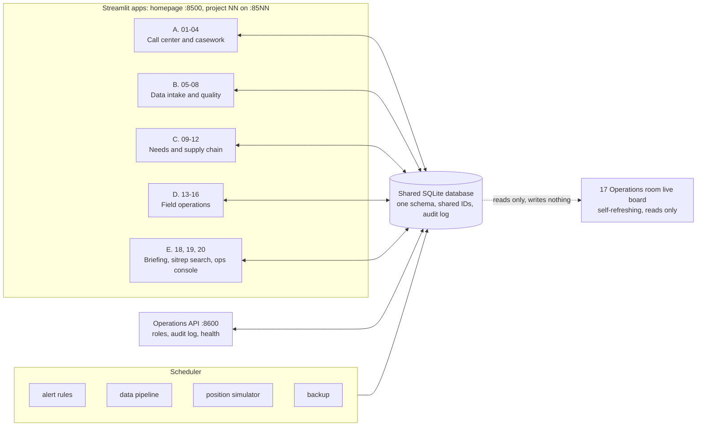

# Waypoint Response Lab

**Twenty demo tools for emergency response teams, over one shared database of fictional data.**

> **Independent portfolio.** Every scenario is fictional and every record is synthetic: people, households, places, vehicles, figures and reports are generated by a seeded script. Nothing here is connected to any real organization, system or dataset.

The tools cover the work of a hotline, caseworkers, data teams, warehouses, distribution sites, a vehicle fleet and an operations room. They are written for two readers:

- **Program managers** who want to try a realistic task: open a demo, follow its "Try this demo" steps, see the result.
- **Engineers** who want to review the code: shared schema, shared domain logic in [`shared/`](shared/), and a test suite that runs with one command.


## Projects

Each link opens the project folder, whose README has the problem, the intended user, a screenshot, the method and limits, and a "Try this demo" walkthrough.

### A. Call center and casework

| # | Project | Who uses it, and what it does |
|---|---|---|
| 01 | [Request dashboard](projects/01-call-center-request-dashboard) | Hotline coordinators and caseworkers track service requests from intake to closure and get a suggested category for each note. |
| 02 | [Calls and complaints](projects/02-call-center-calls-and-complaints) | Hotline operators log every call and link it to a complaint, so repeat calls are not counted as new complaints. |
| 03 | [Call note classifier lab](projects/03-call-note-classifier-lab) | Reviewers train and check a local Arabic and English model for request categories and see where it is wrong. |
| 04 | [Referral tracker](projects/04-beneficiary-referral-tracker) | Caseworkers match a family's need to a service, approve the referral and confirm whether support arrived. |

### B. Data intake and quality

| # | Project | Who uses it, and what it does |
|---|---|---|
| 05 | [Field note to intake form](projects/05-emergency-data-entry) | Data entry staff turn a pasted Arabic or English field note into a draft intake form and fix the flagged gaps. |
| 06 | [Family record checker](projects/06-family-record-checker) | Registration officers find likely duplicate households across spellings and merge them with a recorded decision. |
| 07 | [Field data pipeline](projects/07-field-data-pipeline) | Information management officers validate team spreadsheets, load clean rows once and see why rows were quarantined. |
| 08 | [Offline field sync](projects/08-offline-field-sync) | Field workers capture records offline, sync later and resolve edit conflicts by choosing a version. |

### C. Needs and supply chain

| # | Project | Who uses it, and what it does |
|---|---|---|
| 09 | [Unmet needs map](projects/09-unmet-needs-map) | Program managers compare requested and delivered assistance by area and see where the gap is largest. |
| 10 | [Warehouse stock forecast](projects/10-warehouse-stock-forecast) | Warehouse and supply officers track stock, estimate stockout dates and get replenishment quantities. |
| 11 | [Food distribution tracker](projects/11-food-distribution-tracker) | Site supervisors record parcels and meals per household, see when coverage ends and who is due next. |
| 12 | [Distribution reconciliation](projects/12-distribution-reconciliation-report) | Coordinators and finance reviewers reconcile planned, dispatched, distributed and returned parcels and sign off a report. |

### D. Field operations

| # | Project | Who uses it, and what it does |
|---|---|---|
| 13 | [Volunteer shift planner](projects/13-volunteer-shift-planner) | Volunteer coordinators get assignment suggestions by availability and training, with overlaps and gaps flagged. |
| 14 | [Fleet readiness and tracking](projects/14-fleet-readiness-and-tracking) | Fleet officers see which vehicles are ready, due for service or not ready, and follow last known positions. |
| 15 | [Security situation log](projects/15-security-situation-log) | Duty officers log and verify incidents, read an area status board and confirm or override a movement advisory. |
| 16 | [Convoy dispatch planner](projects/16-convoy-dispatch-planner) | Logistics coordinators plan stops, vehicles and loads within capacity and advisories, then approve and track a convoy. |

### E. Operations room, reporting and platform

| # | Project | Who uses it, and what it does |
|---|---|---|
| 17 | [Operations room live board](projects/17-operations-room-live-board) | Operations room staff watch convoys, requests, advisories, stock alerts and distributions on a self-refreshing display. |
| 18 | [Daily emergency briefing](projects/18-daily-emergency-briefing) | Emergency coordinators generate an editable one-page briefing with sourced figures, then approve and export it. |
| 19 | [Sitrep search assistant](projects/19-sitrep-search-assistant) | Coordinators and analysts search past situation reports and get the best passages with source and date. |
| 20 | [Operations API and alerts](projects/20-operations-api-and-alerts) | Administrators and integrators use a documented API with roles and an audit log, run alert rules and check service health. |

## Setup and launch

Requires Python 3.12. Run everything from the repository root. Nothing needs a network connection, an account or an API key after installation.

**Windows (PowerShell)**

```powershell
python -m venv .venv
.\.venv\Scripts\python.exe -m pip install -r requirements.txt
.\.venv\Scripts\python.exe run.py                # homepage and all 20 projects, opens the homepage
.\.venv\Scripts\python.exe run.py 02             # one project (port 8502)
.\.venv\Scripts\python.exe run.py --reset        # rebuild the demo data
```

**macOS / Linux**

```bash
python3 -m venv .venv
.venv/bin/python -m pip install -r requirements.txt
.venv/bin/python run.py                          # homepage and all 20 projects, opens the homepage
.venv/bin/python run.py 02                       # one project (port 8502)
.venv/bin/python run.py --reset                  # rebuild the demo data
```

`run.py` builds the demo database on first run, starts the homepage on <http://localhost:8500> and each project on port 8500 plus its number (project 02 on 8502). A full launch also starts the operations API (<http://localhost:8600/docs>, or `/reference` when offline) and the scheduler. Stop with Ctrl+C.

| Command (after `python` or `.venv/.../python`) | What it does |
|---|---|
| `run.py` | Homepage, all built projects, API and scheduler |
| `run.py 02 04` | Only these projects (`run.py 20` also starts the API and scheduler) |
| `run.py --home-only` | Only the homepage |
| `run.py --list` | Projects, ports and status |
| `run.py --reset` | Rebuild the demo data and exit |
| `run.py --no-browser`, `--no-services` | Do not open a browser; do not start the API and scheduler |
| `-m streamlit run projects/02-call-center-calls-and-complaints/app.py --server.port 8502` | Start one project with Streamlit directly |

**Reset the demo data.** From the command line use `run.py --reset`. On the homepage, scroll to "Reset the demo data", tick the staff confirmation and press the button; without the tick nothing changes. Set the environment variable `PORTFOLIO_DB_PATH` to use another database file instead of `data/portfolio.db`.

**Tests and style check.** These need the development requirements:

```powershell
.\.venv\Scripts\python.exe -m pip install -r requirements-dev.txt
.\.venv\Scripts\python.exe -m pytest
.\.venv\Scripts\python.exe -m ruff check .
.\.venv\Scripts\python.exe -m ruff format --check .
```

On macOS or Linux use `.venv/bin/python` in place of `.\.venv\Scripts\python.exe`. The same three checks run on every push in [`.github/workflows/ci.yml`](.github/workflows/ci.yml).

## Two ways to run it

**Local demo mode** is the default: one command, no network, no account, no paid key. Background features still work locally: a built-in position simulator, scheduled runs and alert evaluation, each with a "run now" control in Project 20.

**Server mode** runs the whole portfolio continuously on one always-on Linux machine with Docker Compose: the apps, the API, the scheduler and scheduled backups, reachable only over a private network, with a staff login on every page that changes data. Setup, backups and restore are in [`DEPLOYMENT.md`](DEPLOYMENT.md). It is written and statically checked but has not been run under Docker (see Limitations).

## Architecture



- **One schema** in [`shared/schema.sql`](shared/schema.sql) and **one seeded generator** in [`shared/seed.py`](shared/seed.py): the same run always produces the same coherent data.
- **Shared code** in [`shared/`](shared/): database access and audit log, clock, page layout, right-to-left Arabic text, charts with labelled units, staff confirmation, and the calculations several projects use (food coverage, stock ledger, vehicle readiness, movement advisories, classifier).
- **Staff confirmation** is required for consequential actions: referrals, merges, sync conflicts, convoy dispatch, advisory overrides, reconciliation sign-off and briefing approval.

### How the projects connect

- A call in 02 links to a service request in 01 and to a complaint; repeat calls never create a second complaint.
- The classifier trained and evaluated in 03 supplies the category suggestion in 01.
- Referrals in 04 link to households and requests.
- Planned distributions in 11 feed the warehouse forecast in 10, and 12 reconciles plans, dispatches, distributions and returns.
- Vehicle readiness (14) and movement advisories (15) limit what 16 lets a coordinator dispatch.
- Position reports arrive through the API (20) or the simulator; 14 and 17 read them.
- 17 shows data from all the other projects and stores none of its own.

## Stack

Python 3.12, Streamlit, pandas, SQLite, scikit-learn, FastAPI, APScheduler and Plotly. Exact versions are pinned in [`requirements.txt`](requirements.txt) and, for tests and style, [`requirements-dev.txt`](requirements-dev.txt).

## Limitations

All data is fictional and generated, so figures illustrate how a tool behaves and are not evidence about any real operation. The database is one local SQLite file: fine for a demo, not a design for many simultaneous writers. Server mode is written and statically tested but has not been run under Docker. The server login is one shared staff account, not an account per person. Walkthroughs were verified through the domain functions and Streamlit's test harness. Details are listed in `PROGRESS.md` and `DEPLOYMENT.md`.

## For contributors

Decisions are recorded in [`DECISIONS.md`](DECISIONS.md) and status in [`PROGRESS.md`](PROGRESS.md).
