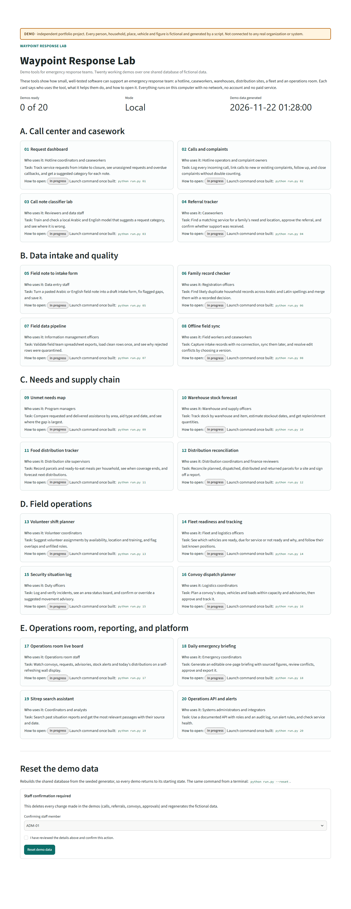
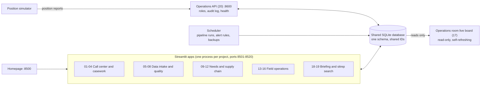

# Waypoint Response Lab

**Twenty demo tools for emergency response teams, over one shared database of fictional data.**

> **Demo status:** independent portfolio project. Every person, household, place, vehicle and figure is fictional and generated by a seeded script. It is not connected to any real organization or system. Projects are being built; the homepage marks each card "In progress" until its demo is finished.

The tools cover the work of a hotline, caseworkers, data teams, warehouses, distribution sites, a vehicle fleet and an operations room. They are written for two audiences: program managers who want to try a realistic task, and engineers who want to read tested code.



## Setup

Requires Python 3.12. Run from the repository root.

```powershell
# Windows (PowerShell)
python -m venv .venv
.\.venv\Scripts\python.exe -m pip install -r requirements-dev.txt
.\.venv\Scripts\python.exe run.py
```

```bash
# Linux / macOS
python3 -m venv .venv
.venv/bin/python -m pip install -r requirements-dev.txt
.venv/bin/python run.py
```

`run.py` builds the demo database on first run, starts the homepage on <http://localhost:8500> and every finished project on its own port (project NN on 8500 + NN), and opens the homepage. Stop with Ctrl+C. Nothing needs a network connection, an account or an API key after installation.

| Command | What it does |
|---|---|
| `python run.py` | Homepage and all finished projects |
| `python run.py 02` | One project (port 8502). Same as `streamlit run projects/02-call-center-calls-and-complaints/app.py --server.port 8502` |
| `python run.py --list` | Projects, ports and status |
| `python run.py --reset` | Rebuild the demo data (also on the homepage, with staff confirmation) |
| `pytest` | Test suite |
| `ruff check . && ruff format --check .` | Style check |

## Projects

| Group | # | Project | Status |
|---|---|---|---|
| A. Call center and casework | 01 | [Request dashboard](projects/01-call-center-request-dashboard) | In progress |
| | 02 | [Calls and complaints](projects/02-call-center-calls-and-complaints) | In progress |
| | 03 | [Call note classifier lab](projects/03-call-note-classifier-lab) | In progress |
| | 04 | [Referral tracker](projects/04-beneficiary-referral-tracker) | In progress |
| B. Data intake and quality | 05 | [Field note to intake form](projects/05-emergency-data-entry) | In progress |
| | 06 | [Family record checker](projects/06-family-record-checker) | In progress |
| | 07 | [Field data pipeline](projects/07-field-data-pipeline) | In progress |
| | 08 | [Offline field sync](projects/08-offline-field-sync) | In progress |
| C. Needs and supply chain | 09 | [Unmet needs map](projects/09-unmet-needs-map) | In progress |
| | 10 | [Warehouse stock forecast](projects/10-warehouse-stock-forecast) | In progress |
| | 11 | [Food distribution tracker](projects/11-food-distribution-tracker) | In progress |
| | 12 | [Distribution reconciliation](projects/12-distribution-reconciliation-report) | In progress |
| D. Field operations | 13 | [Volunteer shift planner](projects/13-volunteer-shift-planner) | In progress |
| | 14 | [Fleet readiness and tracking](projects/14-fleet-readiness-and-tracking) | In progress |
| | 15 | [Security situation log](projects/15-security-situation-log) | In progress |
| | 16 | [Convoy dispatch planner](projects/16-convoy-dispatch-planner) | In progress |
| E. Operations room, reporting, and platform | 17 | [Operations room live board](projects/17-operations-room-live-board) | In progress |
| | 18 | [Daily emergency briefing](projects/18-daily-emergency-briefing) | In progress |
| | 19 | [Sitrep search assistant](projects/19-sitrep-search-assistant) | In progress |
| | 20 | [Operations API and alerts](projects/20-operations-api-and-alerts) | In progress |

## Architecture



- **One schema** for all twenty projects lives in [`shared/schema.sql`](shared/schema.sql). Shared identifiers (households, areas, sites, warehouses, items, vehicles, calls, requests, complaints, distributions, dispatches, convoys, incidents, advisories, alerts) connect the projects. Each activity is stored once, so nothing is counted twice.
- **One seeded generator** ([`shared/seed.py`](shared/seed.py)) fills every table with coherent fictional data, including the records the "Try this demo" walkthroughs use.
- **Shared code** in [`shared/`](shared/): database access and audit log, a freezable clock, page header with the demo banner, Arabic right-to-left text, chart defaults with labelled units, the staff confirmation component, and the calculations several projects share (food coverage, stock ledger, vehicle readiness, advisory rule, classifier).

## Data rules

Fictional household IDs, areas, sites, providers, vehicles (fleet numbers, not plates) and volunteer IDs only. Map positions are on an invented 100 × 100 km grid, not real coordinates. A test scans the seed data and fails on anything shaped like a phone number, email address or IP address.

## For contributors

Project agents follow [`CONTRIBUTING_AGENTS.md`](CONTRIBUTING_AGENTS.md). Progress is tracked in [`PROGRESS.md`](PROGRESS.md) and decisions in [`DECISIONS.md`](DECISIONS.md).
