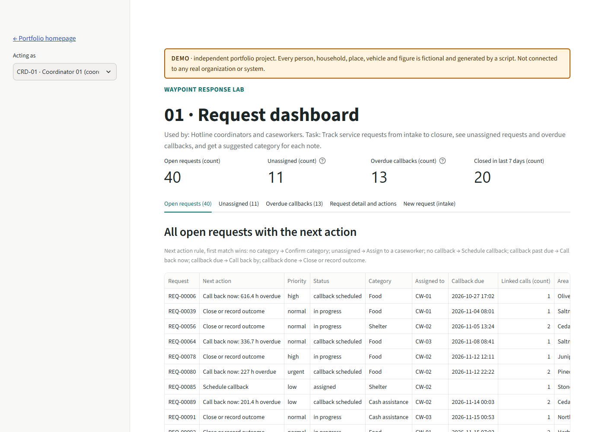

# 01 · Request dashboard

## Problem
A hotline takes service requests all day: food, shelter, health, cash, water and hygiene, protection. Coordinators need to see which requests nobody holds yet, which families are waiting past the promised callback time, and what the next step is for every open request. Operators also need help picking a category from a free-text note in Arabic or English, without a guess being saved when the model is unsure.

## Intended user
Hotline operators (intake, category), coordinators and caseworkers (assignment, callback, closure).

## Technique
- **Classification** for the category suggestion: the shared call-note classifier in `shared/classifier.py` (character n-gram TF-IDF and logistic regression, trained and evaluated in Project 03). This project does not build its own model. When the model's confidence is below the setting `classifier_confidence_threshold` (0.6), the suggestion is stored as blank (`suggested_category` NULL, confidence kept) and the operator must choose the category.
- **Rule-based** next action and overdue status (`p01_requests.next_action`), first match wins:
  1. closed: none
  2. no confirmed category: "Confirm category"
  3. not assigned: "Assign to a caseworker"
  4. no callback scheduled: "Schedule callback"
  5. callback not done and its due time has passed: "Call back now: N h overdue"
  6. callback not done and still due: "Call back by <time>"
  7. callback done: "Close or record outcome"
- A callback is **overdue** when now is strictly after its due time, it is not done, and the request is not closed. At exactly the due time it is not overdue.
- **Straightforward calculation** for the callback due time: assigned time + `callback_sla_hours` (48 h). Staff may choose an earlier time, never a later one.

## Inputs
The shared SQLite database: `service_requests`, `request_events`, `calls` (linked calls from Project 02, counted per request), `households`, `areas`, `staff`, `classifier_notes` (training data for the shared model), and the settings `callback_sla_hours`, `classifier_confidence_threshold` and `demo.scenarios` (key `p01`). Seeded fictional data only. No libraries beyond `requirements.txt`.

## Assumptions
- Steps go in a fixed order: new → assigned → callback scheduled → callback done (in progress) → closed. Any other order is refused with a clear message, and nothing changes.
- The category must be confirmed by a person before a request can be assigned. Requests created by Project 02 or the seed with no category show "Confirm category" first; the suggestion is computed when the request is opened and stored when the category is confirmed.
- Only caseworkers are assigned requests. Coordinators and caseworkers assign, schedule and record callbacks. Operators, caseworkers and coordinators take intake and confirm categories.
- Closing is consequential: it needs a staff confirmation from a caseworker or coordinator (`ui.confirm_action` in the app, `confirm.require_confirmation` in `p01_requests.close`). Outcomes come from the fixed list in the schema.
- Every change writes a `request_events` row and an `audit_log` row (channel `app:01`) in the same transaction. Time comes from `shared.clock`.

## Limitations
- Local demo mode: a sidebar selector picks the acting staff member; there are no accounts.
- A request can be closed only after the callback is done. There is no early close (for example a duplicate found at intake) and no reopening or reassignment; these would be new workflow steps outside the spec row.
- The classifier is the small Project 03 model: many vague or unusually worded notes fall below 0.6 and are left blank on purpose. The model is cached per app session and trained from `classifier_notes` on first use if no saved model exists.
- Data tables do not render Arabic right-to-left, so notes are not shown in tables; the request detail shows the note with `ui.show_text` (right-to-left for Arabic).
- The overdue count uses the current clock, so it grows as real time passes after the seed was built.

## Launch
```
python run.py 01
streamlit run projects/01-call-center-request-dashboard/app.py --server.port 8501
```
Port 8501.

## Screenshot


## Try this demo
Dates move with the seed's anchor time, so the walkthrough request comes from the setting `demo.scenarios`, key `p01`, `unassigned_request_ids`. The first ID on a seed built on 2026-11-22 is **REQ-00113**; with `--anchor 2026-11-16T10:00:00` (the test clock) it is REQ-00112. The tiles and the suggestion shown below were read on a seed built on 2026-11-22; other days can differ slightly, so compare the changes, not the absolute numbers.

1. Open the app (`python run.py 01`). The metric tiles show **Open requests 40, Unassigned 11, Overdue callbacks 13, Closed in last 7 days 20** right after a reset (the overdue count can grow as time passes).
2. Open the tab **Request detail and actions**. The first scenario request (REQ-00113) is already selected: status new, category not confirmed, next action "Confirm category". Arabic notes are shown right-to-left. The box says "Suggested: **Protection** (confidence 0.83, computed now by the classifier)" and the category box is pre-filled with it. (If a request's confidence is below 0.6, the box is blank with a warning and you must choose.) Press **Confirm category**: "REQ-00113: category Protection confirmed."
3. With the sidebar on CRD-01 (coordinator), choose caseworker **CW-01** and press **Assign**. Then leave "Use the default due time … (assigned + 48 h)" ticked and press **Schedule callback**. The due time is exactly the assignment time + 48 hours.
4. Press **Record callback done**. Status: in progress, next action "Close or record outcome".
5. Choose closure outcome **assisted**. Press **Close request** without ticking the box: a warning, nothing changes. Tick "I have reviewed the details…", keep CRD-01 as confirming staff, press **Close request** again.

**Expected result:** "REQ-00113 closed with outcome assisted." Unassigned drops from **11 to 10**, open requests from 40 to 39, closed in last 7 days from 20 to 21. The request shows status closed and a timeline of **6 events**: the seeded `created` event plus the five steps `category_confirmed`, `assigned`, `callback_scheduled`, `callback_done`, `closed`.

6. Intake: open **New request (intake)** and type `Family of 6 has no food left, asking for a food parcel and rice.` The app shows "Suggested category: **Food** (confidence 0.91)" and pre-fills Food. Press **Save request**: "Saved REQ-00131 with category Food (status new)." The new request appears under Unassigned (one more than before). A vague note such as `need help please` gets no suggestion (confidence 0.23) and cannot be saved until the operator chooses a category.

## Tests
`tests/test_p01_request_dashboard.py` (27 tests) covers: the app starts (`app_test(1)`); the next-action rule for every status and case; overdue exactly at, just before and just after the due time, and never for done or closed callbacks; the default due time = assigned + SLA hours, including a changed SLA setting, an earlier time allowed and a later one refused; the unassigned and overdue lists and the metrics against direct SQL on the seed; linked calls counts; a Project 02 style request without a category; intake storing a confident suggestion; intake with a low-confidence note storing `suggested_category` NULL and refusing to save without the operator's category (Part 4: low-confidence predictions are left blank); the suggestion coming from `shared.classifier.predict` with the threshold setting; confirming the category of a seeded request; the full lifecycle with events and audit rows; invalid transitions and roles raising; closing without a valid confirmation raising `ConfirmationRequired` and changing nothing; and the walkthrough above driven through the app with `AppTest`.
