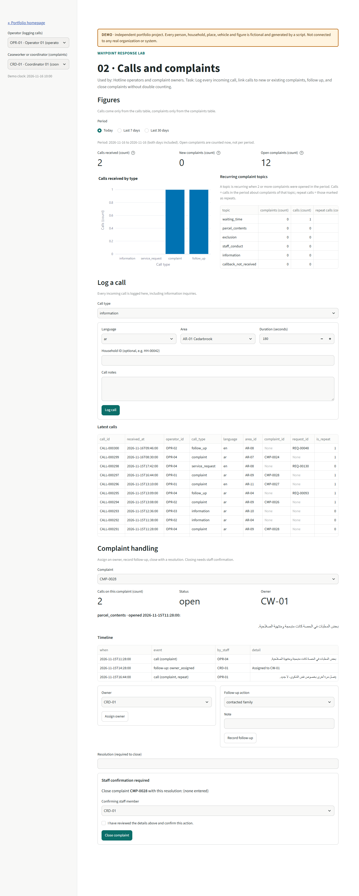

# 02 · Calls and complaints

## Problem
A hotline receives information inquiries, service requests and complaints, and the same family often calls again about the same complaint. If each call becomes a new complaint, the complaint count is inflated and nobody sees that one issue keeps coming back. If calls are not logged at all, the call volume is invisible.

## Intended user
Hotline operators (log calls) and complaint owners: caseworkers and coordinators (assign, follow up, close).

## Technique
Straightforward calculation (counts and grouping over the shared database). No model, no estimation.

## Inputs
- `calls`: every incoming call (type, language, area, optional household, notes, duration, optional `complaint_id` / `request_id`, `is_repeat`).
- `complaints`, `complaint_followups`, view `v_complaint_call_counts`.
- `service_requests` and `request_events`: a service-request call can create a request (status `new`, no category yet, a `created` event). Project 01 then confirms its category and assigns it.
- `households`, `areas`, `staff` (operators, caseworkers, coordinators).
- Complaint topics: the keys of `COMPLAINT_TOPICS` in `shared/seed_content.py`.

## Assumptions
- **Counting rule**: calls are counted only from `calls` rows and complaints only from `complaints` rows; one is never derived from the other. A repeat call adds a call row with `is_repeat = 1` and never a complaint row.
- **Periods**: Today, Last 7 days, Last 30 days. They end today (demo clock) and include both the first and the last day.
- **Calls received**: all call types, repeat calls included, by `received_at` date.
- **New complaints**: complaint rows whose `opened_at` falls in the period.
- **Open complaints**: complaints whose status is not `closed`, right now (not per period).
- **Recurring topic**: a topic with 2 or more complaints opened in the period. The table also shows calls in the period about complaints of that topic, and how many of those are repeat calls.
- Logging in as an operator; owners must be a caseworker or coordinator; closing needs a caseworker or coordinator (an admin is also accepted by the shared confirmation rule).
- A call can only link to an open complaint or request, never a closed one.

## Limitations
- Choosing the "existing complaint" is manual; the app does not suggest which complaint a caller is talking about.
- Calls cannot be edited or deleted after logging, and a complaint cannot be reopened (the `reopened` action exists in the schema but is outside this spec row).
- A service-request call only creates the request. Its category, assignment and callback belong to Project 01.
- Household ID is typed in and only checked to exist.
- The period figures use calendar days of the demo clock, not a rolling 24-hour window.

## Launch
```powershell
.\.venv\Scripts\python.exe run.py 02
# or
.\.venv\Scripts\streamlit.exe run projects/02-call-center-calls-and-complaints/app.py --server.port 8502
```
Port 8502.

## Screenshot


## Try this demo
The figures below are for a database built with the anchor the tests use, with the demo clock frozen at the same moment:

```powershell
$env:PORTFOLIO_DB_PATH = "data\agent02.db"
$env:PORTFOLIO_FROZEN_NOW = "2026-11-16T10:00:00"
.\.venv\Scripts\python.exe -m shared.seed --reset --anchor 2026-11-16T10:00:00
.\.venv\Scripts\python.exe run.py 02
```

1. Open http://localhost:8502. With **Period = Today**, note the figures: **Calls received 2**, **New complaints 0**, **Open complaints 12**.
2. Under **Log a call**, choose Call type **complaint** and Complaint link **New complaint**. Pick Area **AR-01 Cedarbrook**, Complaint topic **waiting_time**, type a note ("Waited more than four hours."), and press **Log call** (operator in the sidebar: OPR-01). The page reports the new complaint **CMP-0029**.
3. Choose Call type **complaint** again, Complaint link **Existing open complaint**, pick **CMP-0029**, type a note ("Calling again about the same complaint.") and press **Log call**. The call is marked as a repeat.
4. **Expected result**: Calls received **4** (+2), New complaints **1** (+1), Open complaints **13**. Under **Complaint handling**, select CMP-0029: **Calls on this complaint = 2**, and the timeline lists both calls (the second marked "repeat"). Two incoming calls, one complaint.
5. Optional: in the same section choose an owner and press **Assign owner** (status becomes in progress), record a follow-up, then enter a resolution and press **Close complaint**. Tick the confirmation box first; without it nothing changes. The complaint then shows status closed and Open complaints drops back to 12.

## Tests
`tests/test_p02_calls_complaints.py` (15 tests): the app starts; the Part 4 repeat-call test (calls +2, complaints +1, that complaint's call count 2, `is_repeat` 0 then 1); period figures against direct SQL; recurring topics; information calls add no complaint; a service-request call creates exactly one linked request with a `created` event; follow-up calls; invalid calls write nothing; no links to closed complaints; owner assignment and follow-ups with audit rows; closing without confirmation raises `ConfirmationRequired` and leaves the complaint open; closing with confirmation; and the walkthrough, both through the domain functions and clicked through the page with `AppTest`.

No extra libraries beyond `requirements.txt`.
