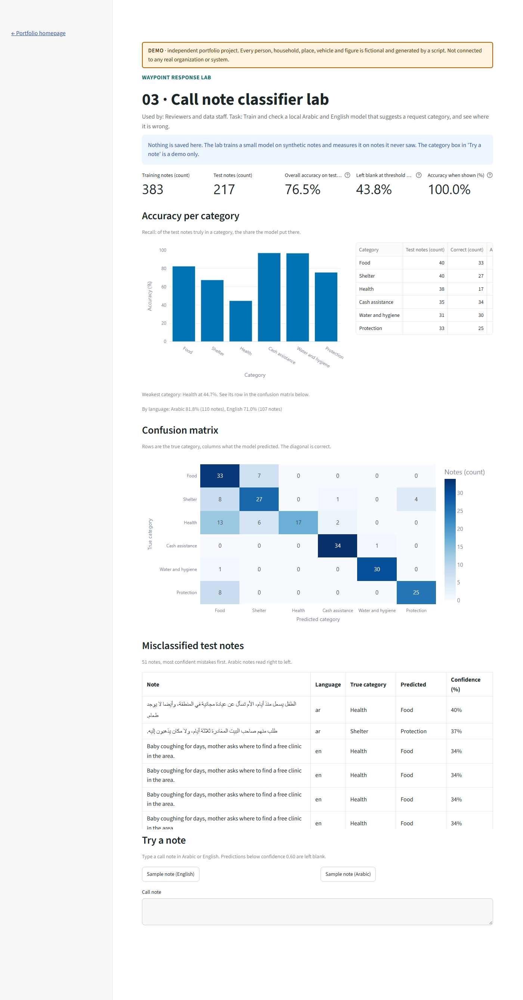

# 03 · Call note classifier lab

## Problem
Project 01 suggests a request category for each call note. Before anyone trusts that suggestion, reviewers need to see how well the model works, where it is wrong, and what it does when it is unsure.

## Intended user
Reviewers and data staff.

## Technique
Classification. The shared model (`shared/classifier.py`) is a character n-gram TF-IDF feeding a logistic regression, trained locally on the synthetic Arabic and English notes in `classifier_notes`. This project does not copy the model; it evaluates it. Project 01 uses the same model, so these numbers are the evidence for 01.

## Inputs
Table `classifier_notes` (600 labelled synthetic notes: 383 train, 217 test) and the setting `classifier_confidence_threshold` (0.6).

## Assumptions
- The notes are synthetic and templated. Each category and language has several held-out note templates that never appear in training (about 15% of the notes use them; they go only to the test split), plus enough other notes to make the test split 217 notes, so the test also measures new phrasing. Training and held-out templates share the same category vocabulary (for example medicine, doctor, clinic, hospital for Health; rice, bread, groceries, meals for Food) but never the same sentences.
- A prediction is shown when its confidence is at or above the threshold; below it the category is left blank for the operator (`shared.classifier.predict`).
- The app trains once per session from the current database, so the shown model always matches the data.
- **No consequential action exists here.** The app saves nothing. The operator's category box in "Try a note" is a demo only.

## Limitations
- Because the notes are templated, real call notes would score lower than the figures here. The held-out phrasing test gives 90.8% (197 of 217 = 0.908; it was 76.5% before the notes and the model were improved); realistic accuracy is lower still.
- Shelter is the weakest category (83.3%, 20 of 24): its test notes are sometimes predicted as Protection (3) or Cash assistance (1). Health, which was the weakest at 44.7% and mostly confused with Food, is now 86.8% (33 of 38); its remaining mistakes are 5 notes predicted as Shelter.
- At threshold 0.6, 23.0% of test notes (50 of 217) are left blank; the 167 shown are 97.0% correct (162 of 167). Before the improvement 43.8% were left blank. That is a property of this seed, not a guarantee.
- Some notes mention two needs and are labelled with the first, so a few mistakes are partly the labels' fault.

## Launch
`python run.py 3`, or `streamlit run projects/03-call-note-classifier-lab/app.py --server.port 8503`. Port 8503.

## Screenshot

## Try this demo
Every figure below comes from the 600 fixed synthetic notes (and the fixed threshold 0.6), which the seed writes the same way whatever day or time it runs, so none of these numbers depends on the seed date. Nothing in this app is stored, so the walkthrough changes nothing.

1. Open the app. Expect 383 training notes, 217 test notes, overall accuracy 90.8%, 23.0% left blank at threshold 0.60, accuracy when shown 97.0%.
2. In "Accuracy per category" the weakest bar is Shelter (83.3%); Health is 86.8%, Cash assistance 90.0%, Food 87.2%, Water and hygiene and Protection 97.4%. In the confusion matrix the Shelter row shows 20 correct, 3 predicted as Protection and 1 as Cash assistance; the Health row shows 33 correct and 5 predicted as Shelter.
3. In "Try a note" type `Family of 6 has no food left, asking for a food parcel and rice.` Expect "Predicted category: Food (confidence 100%)" and the probability per category.
4. Type `Caller asked a general question about the office.` Expect "Left blank for the operator: confidence 38% below threshold 60%", the top guess (Food) as a hint only, and a selectbox where you can fill in a category (not saved).
5. The sample buttons fill an English and an Arabic note; the English one is predicted Food (100%) and the Arabic water note is predicted Water and hygiene (confidence 92%).

## Tests
`tests/test_p03_classifier_lab.py`: app starts; confusion matrix sums to the test count; diagonal over total equals accuracy (0.908); per-category counts match; misclassified list equals the off-diagonal count; low-confidence predictions are left blank below, at and above the threshold (tiny threshold and 1.0); empty text is blank; threshold read from settings; the "Try a note" walkthrough in AppTest (clear note gives Food, vague note left blank, Arabic sample gives Water and hygiene) the summary figures and weakest category, and the quality targets (accuracy at least 85%, under 25% left blank, no category under 70%).

Libraries: scikit-learn, plotly, pandas (already in the shared requirements).
