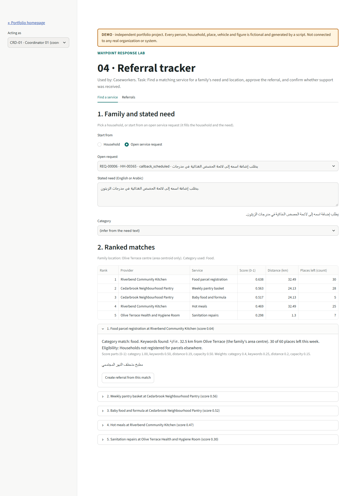

# 04 · Referral tracker

## Problem

A caseworker hears a family's need ("my child has had a fever for three days") and must find a service that fits the need, is near the family, and still has room. Then the referral has to be approved, the provider's answer recorded, and the outcome confirmed, so no family is sent to a service that cannot help and nobody is left wondering whether support arrived.

## Intended user

Caseworkers (and coordinators who approve referrals).

## Technique

Rule-based scoring with plain-language explanations. No model is trained and nothing leaves the machine.

For every service in the fictional directory, a score between 0 and 1 is the weighted sum of four components (each 0 to 1):

| Component | Weight | How it is computed |
|---|---|---|
| Category match | 0.40 | 1 if the service category equals the chosen category (or the category inferred from the need), else 0 |
| Keyword overlap | 0.25 | distinct service keywords found in the need text; 2 or more hits = 1.0, 1 hit = 0.5, none = 0 |
| Distance | 0.20 | `1 - km / 40`, floored at 0, where km is `shared.geo.distance_km` from the family's area centroid to the provider (grid km x 1.3 road factor) |
| Remaining capacity | 0.15 | `(weekly_capacity - current_load) / weekly_capacity` |

Services that do not accept new referrals, or have no places left this week, are **excluded** (not ranked) and shown with the reason when they would otherwise be relevant (right category or a keyword hit). Ranked matches are sorted by score, then distance. Each match has an explanation: category, keywords found, distance from the family's area, places left, and the service's eligibility text.

Text handling: lower-casing, simple tokenising, Arabic diacritics removed, alef/ya/ta-marbuta forms unified, the Arabic article and the one-letter prefixes waw/ba/lam tolerated, English plural "s" tolerated. If the caseworker does not choose a category, the category with the most keyword hits across the directory is used.

Referral lifecycle: `proposed` -> `approved` (staff confirmation) -> provider response `accepted` or `declined` (staff confirmation; declined ends it) -> family received support, yes or no (staff confirmation) -> `support_received` or `support_not_received`. Out-of-order steps raise `InvalidTransition`. Every change is written to the audit log (`channel = app:04`).

## Inputs

Seeded database (`shared/schema.sql`): `households` and `areas` (location is the area centroid only), `service_requests` (an open request fills the household and the need), `service_providers`, `provider_services` (keywords in English and Arabic, weekly capacity and load, eligibility, `accepts_new`), `referrals`, `staff`. All data is fictional.

## Assumptions

- The family's location is its area centroid on the invented grid; no precise household location is stored.
- A place is "left" when `weekly_capacity - current_load > 0`. Creating or accepting a referral does not change `current_load` (the directory load is maintained by the provider, outside this app).
- Weights and cutoffs above are simple, editable constants at the top of `p04_referrals.py`; they are not tuned on outcome data.
- Referral approval and outcome confirmation can be made by a caseworker or coordinator (admin also passes the shared check).

## Limitations

- Keyword matching is literal after light normalisation; it does not understand synonyms ("medicine" does not match "medication"). The caseworker can pick the category by hand.
- Distance is straight-line on the grid times 1.3, not a road route. Provider opening days and languages are not scored.
- No duplicate-referral check across providers; the caseworker decides.
- Local demo mode: a sidebar role selector, no accounts.

## Launch

```powershell
.\.venv\Scripts\python.exe run.py 04
# or
.\.venv\Scripts\streamlit.exe run projects/04-beneficiary-referral-tracker/app.py --server.port 8504
```

Port 8504. Use your own database copy with `$env:PORTFOLIO_DB_PATH` if other apps are running.

## Screenshot



## Try this demo

Nothing in the matching depends on the date: the household register, the service directory and its capacities are fixed seed content, so the scores, distances and places-left below are the same whatever day or time the seed runs. Referral IDs are the next free number, so the ID is read from the page. On a freshly seeded database:

1. Open the app and stay on **Find a service**. Set Start from to **Household** (the demo opens on "Open service request") and choose `HH-00009` (Harbor Flats, household of 4). Before you start, open the **Referrals** tab once and note the **Support received** tile, then return to **Find a service**.
2. Enter the need `My child has had a fever for three days and we need medicine.` and leave Category on "infer from the need text".
3. **Expected:** category used is Health; the top match is **General clinic at Harbor Flats Health Point** (score 0.74, 1.4 km, 10 of 80 places left), explained as "Category match: health. Keywords found: fever. 1.4 km from Harbor Flats (the family's area centre). 10 of 80 places left this week. Eligibility: Free for all residents; children prioritised."
4. Open the first match and click **Create referral from this match**. **Expected:** a message "Referral REF-... created with status proposed" (note the ID; it is the next free referral number).
5. Go to the **Referrals** tab, open that referral, tick the confirmation box and click **Approve referral**. **Expected:** "REF-... approved by <staff>", status approved, next step "Record the provider's response (staff confirmation)". Clicking **Approve referral** without the tick changes nothing.
6. Choose **accepted**, add a note, tick the confirmation box and click **Record provider response**. Without the tick nothing changes. **Expected:** status accepted, next step "Confirm whether the family received support".
7. Choose **Yes** for "Did the family receive support?", tick the confirmation box, click **Confirm outcome**. **Expected:** the referral shows status **support_received** and the **Support received** tile is 1 higher than in step 1; filter by that status to see the referral listed first (newest first). The other tiles do not change.
8. Optional: back on **Find a service**, for a school-fee need (`School fees for my two children`) with category Cash, "School fees support" appears under **Excluded services** (not accepting new referrals and no places left this week).

## Tests

`tests/test_p04_referrals.py` covers: the app starts; each score component and the weighted sum; a health need ranking a health service first; category by hand or inferred; excluded services (no capacity, not accepting) with reasons; the explanation naming category, keywords, distance and capacity; Arabic need text matching Arabic keywords and Arabic normalisation; distance from the area centroid; the status order and declined ending the referral; approval and outcome refusing to run without confirmation and changing nothing; the full lifecycle with audit entries; the referral list and status filter; the walkthrough above; and the whole flow through the Streamlit widgets.

No extra libraries beyond `requirements.txt`.
