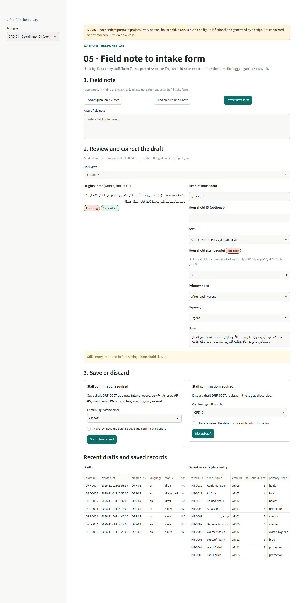

# 05 · Field note to intake form

## Problem

Field staff send short notes in Arabic or English ("Head of household: ..., family of five, no food, urgent"). Someone has to retype each one into an intake form, and details get lost or guessed. This app turns a pasted note into a draft intake form, shows what was found and what is missing or doubtful, and lets staff correct the draft before anything is saved.

## Intended user

Data entry staff (roles operator, caseworker, coordinator).

## Technique

Text extraction, rule-based: regular expressions and keyword lists in English and Arabic. No model, no paid API, no download. Arabic text is normalised first (diacritics removed, alef/ya/ta-marbuta variants merged, Arabic-Indic digits turned into ASCII digits).

- `head_name`: trigger phrases ("head of household", "name is", "Mr/Mrs", "رب الأسرة", "الاسم").
- `household_id`: `HH-NNNNN`, checked against the household register.
- `area_id`: English name, Arabic name or `AR-NN` code from the `areas` table; a close spelling (similarity 0.85 or more) is a fuzzy match.
- `household_size`: digits, Arabic-Indic digits and number words one to twelve in both languages, only in size context ("family of five", "عائلة من ٦ أشخاص"). "3 children" is not a household size.
- `primary_need`: one of the six categories, by keyword count (ties go to the first mentioned).
- `urgency`: low / urgent / high cue words; "normal" is the default.
- `language`: `ui.has_arabic`.

Flags: **missing** = head_name, area_id, household_size or primary_need not found. **uncertain** = several areas, several needs, a fuzzy area, several different sizes, a household ID not in the register, a one-word name, or urgency guessed by default. Each flag shows its reason beside the field.

## Inputs

- A pasted note (or `sample_data/note_en.txt`, `sample_data/note_ar.txt`, loaded with a button).
- The `areas` and `households` tables, and staff for confirmation.
- Tables written: `intake_drafts`, `intake_records`, `record_versions`, `audit_log` (channel `app:05`).

## Assumptions

- A note describes one household.
- The first area mentioned is the household's area; the first size stated is its size.
- Staff review every draft; extraction only proposes.

## Limitations

- Keyword rules, not understanding: negation ("no fever") and unusual phrasing are not handled; unlisted spellings are missed.
- Number words only go to twelve; no phone numbers or addresses are extracted.
- Names are found only after a trigger phrase, and Arabic names stop at the first stopword or punctuation (at most three words).
- Fuzzy matching covers area names only.
- No fallback was needed.

## Launch

```
python run.py 05
streamlit run projects/05-emergency-data-entry/app.py --server.port 8505
```

Port 8505. No extra libraries beyond `requirements.txt`.

## Screenshot



## Try this demo

On a fresh database (`python -m shared.seed --reset`), with the app open, as any operator, caseworker or coordinator:

1. Click **Load english sample note**, then **Extract draft form**. A draft `DRF-0007` is created. Expected: head of household `Samir Nassar`, area `AR-08 Riverbend`, size `5`, need `Food`, urgency `urgent`; nothing missing; **primary need flagged CHECK** ("Several needs mentioned: food, shelter") because of the leaking roof.
2. Leave the need as Food (or change it), tick the confirmation box and press **Save intake record**. Expected: record `INT-0037` (version 1, source data_entry, language en) with Samir Nassar, AR-08, 5, food, urgent; draft DRF-0007 becomes saved.
3. Click **Load arabic sample note**, **Extract draft form**. Expected: head `ليلى منصور`, area `AR-05 Northfield`, need Water and hygiene, urgency urgent; **household size flagged MISSING** and the warning "Still empty: household size". Saving now is refused.
4. Set household size to 4, confirm and save. Expected: record `INT-0038` (language ar, size 4, water_hygiene), draft saved. The recent tables show both; the audit log has `app:05` rows.

Observed on a fresh copy through the domain functions: exactly the results above (INT-0037, INT-0038).

## Tests

`tests/test_p05_data_entry.py` (48 tests): both sample notes, Arabic-Indic digits and number words, area by English name, Arabic name and code, fuzzy and double areas, need and urgency keywords in both languages, ambiguous or missing fields flagged, household ID check, save without confirmation raises `ConfirmationRequired` and writes nothing, save refuses an empty required field, confirmed save writes record, version 1, draft status and audit row, staff corrections are what is saved, discard, and the app starting and extracting a sample.
