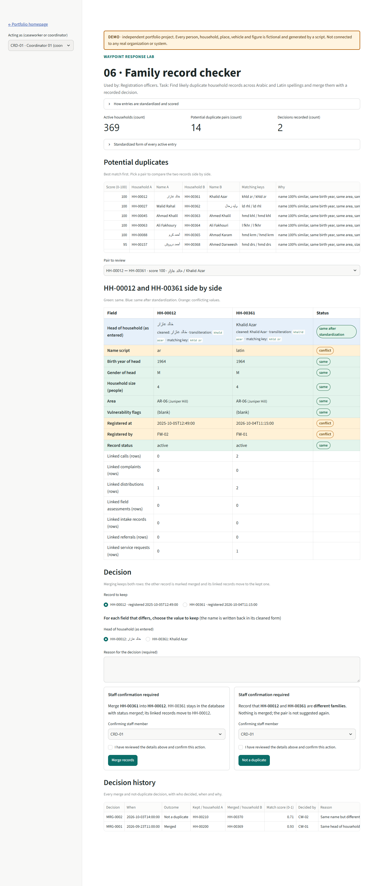

# 06 · Family record checker

## Problem

The same family often gets registered twice: once in Arabic script, once in Latin letters, or with a different spelling ("Mohammad" / "Muhammad", "Fatima" / "Fatmeh"), or again after a move to another area. Duplicates inflate caseloads and split one family's calls, requests and distributions across two records. Merging the wrong two families is just as harmful, so a person has to make the decision and it has to be recorded.

This app standardizes the entries, flags likely duplicate households, shows the two records side by side with matching and conflicting details, and lets a caseworker or coordinator merge them (or record "not a duplicate") after an explicit confirmation. Every decision goes into a history with full snapshots.

## Intended user

Registration officers: caseworkers and coordinators who keep the household register clean.

## Technique

**Fuzzy matching** (rapidfuzz) on standardized names, combined with a documented score.

1. **Standardize** each name: Unicode NFKC, trim and collapse spaces, case-fold; remove Arabic diacritics and tatweel; أ إ آ ٱ → ا, ة → ه, ى → ي, ؤ → و, ئ → ي; drop a hyphenated *al-* / *el-* prefix.
2. **Transliterate** Arabic letter by letter (ح → h, خ → kh, ش → sh, ع dropped, و → w/u, ي → y/i, final ه → a, ...).
3. **Consonant skeleton** per word: vowels (a e i o u y w) removed, q read as k, doubled letters collapsed, a final h dropped. *Mohammad*, *Muhammad*, *Mhamad* and *محمد* all become `mhmd`; *Fatima*, *Fatmeh* and *فاطمة* become `ftm`.
4. **Name similarity** (0 to 1): first name against first name, family against family; each word scores the higher of rapidfuzz `ratio` on its skeleton and on its transliteration; the weaker word counts (so a shared family name alone is not enough). Names with a different number of words use `token_sort_ratio` on the whole name.
5. **Score** (0 to 100) = 50 × name similarity + 20 × birth year (same 1, one year apart 0.5) + 10 × gender (same 1) + 10 × area (same 1) + 10 × household size (same 1, one apart 0.5). A missing birth year or gender counts 0.5.
6. A pair is **flagged** when the score is **80 or more** and the name similarity is **0.85 or more**.
7. **Blocking**: only pairs born within one year of each other, or sharing a family-name skeleton, are scored (about 0.4 s for 370 households).

The standardized form (cleaned name, transliteration, matching key) is shown next to every original entry, in an expandable table and in the side-by-side view. A merge writes the chosen name back in its cleaned form.

Extra library: `rapidfuzz` (already in `requirements.txt`).

## Inputs

- `households` (only `status = 'active'` rows are compared).
- `merge_history`: any pair already decided (merged or not a duplicate) is never suggested again.
- Child tables found from the schema's foreign keys to `households.household_id`: `service_requests`, `complaints`, `calls`, `referrals`, `intake_records`, `field_assessments`, `distributions`.
- The confirming staff member (caseworker or coordinator; admin is also accepted by `shared.confirm`) and a written reason.

## Assumptions

- Head-of-household name, birth year, gender, area and household size are the identifying fields; the weights above reflect that the name matters most.
- A family that moved keeps the same head, name and birth year, so a different area lowers the score but does not rule a pair out.
- The record to keep defaults to household A (the lower ID, usually the earlier registration); staff can choose the other. Fields not chosen keep the kept record's value; `registered_at` and `registered_by` always stay with the kept record (the other record's values remain in its own row and in the snapshot).
- `match_score` is stored in `merge_history` as a fraction (0 to 1), like the seeded history rows.

## Limitations

- The transliteration and skeleton are simple rules, not a linguistic model. Very short names collapse to short keys (*Ali* → `l`), and a few spellings do not reduce to the same key (*Ahmet* → `hmt`, *Ahmad* → `hmd`); those pairs are only found if the other fields push the score over the threshold.
- Two different people with the same common name, birth year and size will be flagged. That is intended: the demo data contains six such look-alikes (the pairs in the list that are not in `demo.scenarios`) for staff to judge.
- A merge cannot be undone from the app. The history keeps full snapshots and the exact list of moved records, so it can be reversed by hand.
- Re-pointing `intake_records.household_id` does not create a new intake record version (the household link is not part of the versioned intake fields).
- No fallback technique was needed.

## Launch

```powershell
.\.venv\Scripts\python.exe run.py 06
# or
.\.venv\Scripts\streamlit.exe run projects/06-family-record-checker/app.py --server.port 8506
```

Opens on port **8506**.

## Screenshot



## Try this demo

Start from freshly seeded data (`python -m shared.seed --reset`).

The households are referred to by ID. The planted pairs are listed in the setting `demo.scenarios` under `p06` (`duplicate_pairs`, `already_merged`, `judged_not_duplicate`); read them with `json.loads(db.get_setting("demo.scenarios"))["p06"]`. Below, "pair 5" is the fifth entry of `duplicate_pairs` (on the standard seed HH-00088 and HH-00365, variation `arabic_script`).

1. Open the app. In the sidebar choose **CW-01 · Caseworker 01**. Expected: the metrics show the active households (369), the potential duplicate pairs (14) and the decisions recorded (2). The list contains all 8 planted pairs (scores 90 to 100) and the remaining look-alike pairs (same name, birth year and size, scores 80 to 90). The already merged household and the pair in `judged_not_duplicate` are not in the list.
2. In **Pair to review** choose the pair from `duplicate_pairs` entry 5. The side-by-side table shows each field with its status: the name row is blue **same after standardization** (both names have the same matching key, Arabic names shown right-to-left), birth year, gender and size are green **same**, and name script and registration details are orange **conflict**. The counts of linked service requests, complaints, calls, referrals, intake records, assessments and distributions for the other household are shown (on the standard seed: 1 request, 2 calls, 2 distributions, no complaints).
3. Keep household A (the first ID), leave the name choice on A, type a reason (for example "Same head of household in two scripts; same birth year, area and size."), choose **CW-01** in the merge form, tick the confirmation box and press **Merge records**.
4. **Expected result:** "MRG-0003: <B> merged into <A>; N linked record(s) moved." (N = 5 on the standard seed). Household B still exists with status `merged` and `merged_into = <A>`; its linked records now point at <A>; the metrics show 368 active households, 13 pairs, 3 decisions; the history lists MRG-0003 with CW-01, the time, the reason and the records moved.
5. Choose any remaining pair that is not in `duplicate_pairs` (a look-alike). Type a reason, tick the box in the **Not a duplicate** form and press it. **Expected result:** "MRG-0004: <A> and <B> recorded as not a duplicate."; no household changes; the pair leaves the list (12 pairs) and appears in the history.
6. Pressing a confirmation button without ticking the box shows "Tick the confirmation box first. Nothing was changed."

## Tests

`tests/test_p06_record_checker.py` (Part 4: duplicate merges: confirmation required, history preserved, no records lost):

- Arabic letter normalization (alef forms, taa marbuta, alef maqsura, diacritics, tatweel), cleaning, transliteration, and skeleton equalities across Arabic and Latin spellings; the word-by-word name similarity; each part of the score.
- All 8 planted duplicate pairs are flagged above the threshold; the already merged household and the pair judged not a duplicate are never suggested (and would be without the history row).
- The side-by-side comparison marks same / same after standardization / conflict.
- Merge without confirmation (no staff, unknown staff, wrong role) raises `ConfirmationRequired` and changes nothing; a reason is required; invalid field choices are refused.
- Merge with confirmation: household count unchanged, other record `merged` with `merged_into`, every child row re-pointed with the total child row count unchanged, `PRAGMA foreign_key_check` clean, `merge_history` holds both snapshots, field choices and the exact moved records, an audit row on `app:06`; the pair cannot be merged again.
- Not-a-duplicate decision is recorded with confirmation and reason, changes no household and removes the pair from the list.
- The app starts (`app_test(6)`), and a merge through the confirmation form works only after the box is ticked.
