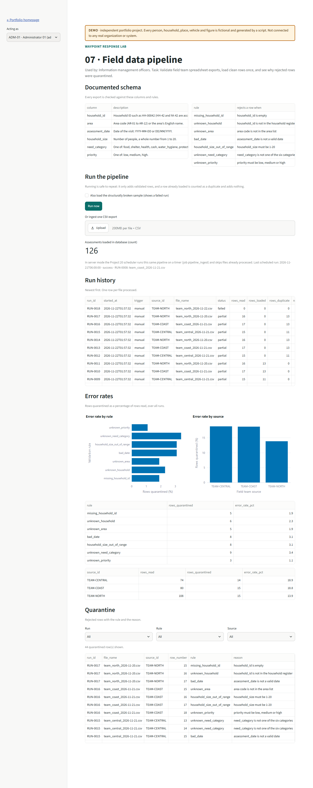

# 07 · Field data pipeline

## Problem
Field teams send weekly spreadsheet exports with inconsistent headers, dates, area names and codes. Information managers need the clean rows in the shared database, the bad rows set aside with a reason, and proof that re-sending a file does not double the data.

## Intended user
Information management officers.

## Technique
Rule-based validation against a documented schema (the engine is `shared/pipeline.py`, shared with the Project 20 scheduler). Error rates are a straightforward calculation: quarantined rows / rows read x 100, by rule and by source (`p07_stats.py`).

## Inputs
- CSV exports whose file name matches a source pattern in `pipeline_sources` (`team_north_*.csv`, `team_coast_*.csv`, `team_central_*.csv`).
- Sample files in `sample_data/` (fictional, deliberately messy) and one structurally broken file in `sample_data/broken/` (not loaded by default).
- Tables: `pipeline_sources`, `pipeline_runs`, `pipeline_quarantine`, `field_assessments`, `households`, `areas`, `job_runs`.

### Documented schema
| Column | Rule |
|---|---|
| `household_id` | HH-00042 (HH-42 and hh 42 are padded); must exist in the household register |
| `area` | Area code AR-01..AR-12 or the English area name |
| `assessment_date` | YYYY-MM-DD or DD/MM/YYYY |
| `household_size` | Whole number 1-20 |
| `need_category` | food, shelter, health, cash, water_hygiene, protection (`wash`/`water` accepted) |
| `priority` | low, medium, high |

Header variants are tidied (`HH ID`, `Visit Date`, `Family Size`, `Need`, ...). Rules (rule name: rejects when): `missing_household_id`, `unknown_household`, `unknown_area`, `bad_date`, `household_size_out_of_range`, `unknown_need_category`, `unknown_priority`. A file missing a required column, or with an unknown name, is a `failed` run and loads nothing. Loaded rows get a unique `row_key`, so a row already loaded counts as a duplicate and adds nothing.

### Sample files and expected counts
| File | Read | Loaded | Quarantined |
|---|---|---|---|
| `team_north_2026-11-20.csv` | 16 | 13 | 3: missing_household_id 1, unknown_household 1, bad_date 1 |
| `team_coast_2026-11-21.csv` | 17 | 13 | 4: unknown_area 1, household_size_out_of_range 2, unknown_priority 1 |
| `team_central_2026-11-21.csv` | 15 | 11 | 4: unknown_need_category 2, bad_date 1, unknown_household 1 |
| `broken/team_north_2026-11-22.csv` | 0 | 0 | failed run (missing `household_id`) |

All three together: 48 read, 37 loaded, 11 quarantined. Second run: 0 loaded, 37 duplicates.

## Assumptions
- Running the pipeline is not a consequential, hard-to-undo action (it only adds validated rows and is safe to re-run), so "Run now" needs no staff confirmation. The sidebar staff selector only sets the audit actor.
- Error rates count all runs, including repeat loads (rows quarantined again on a repeat load are counted again). By rule, the denominator is all rows read.
- Seeded past runs refer to files that do not exist; the sample files are new, so scheduled runs would process them once.

## Limitations
- CSV only (UTF-8). No Excel parsing.
- No schedule runs here: in server mode the Project 20 scheduler runs the same `run_pipeline` on a timer (job `pipeline_ingest`) and skips files already processed; this app shows the last scheduled run.
- Duplicate detection is by exact natural key (source, household, date, need), not fuzzy.

## Launch
```
python run.py 07
streamlit run projects/07-field-data-pipeline/app.py --server.port 8507
```

## Screenshot


## Try this demo
1. Open the app (seeded database: 89 assessments, 8 past runs). Note the schema tables and the last scheduled run.
2. Click **Run now**. Expected: status partial, 48 read, 37 loaded, 0 duplicates, 11 quarantined; assessments 89 -> 126; three new runs at the top of the history.
3. Click **Run now** again. Expected: 0 loaded, 37 duplicates; assessments stay 126.
4. Tick the broken-sample box and run. Expected: one `failed` run for `team_north_2026-11-22.csv` with the missing-column message; nothing loaded.
5. Read the error-rate charts (by rule and by source) and filter the quarantine table by run, rule and source. Each of the seven rules appears.
6. Optionally upload one of the sample CSVs: all rows are duplicates.

Observed on a fresh seeded copy: steps 2-4 gave exactly these numbers (126 assessments after both runs and after the broken run).

## Tests
`tests/test_p07_field_pipeline.py`: expected counts and rules per sample file, every rule covered, tidy-up of headers and values, repeated runs and repeated files add no rows, scheduled run skips processed files, the broken file fails with nothing loaded, error rate calculation by rule and source on known data, quarantine filters, run history order, and the app starting and "Run now" working twice in AppTest. No extra libraries.
