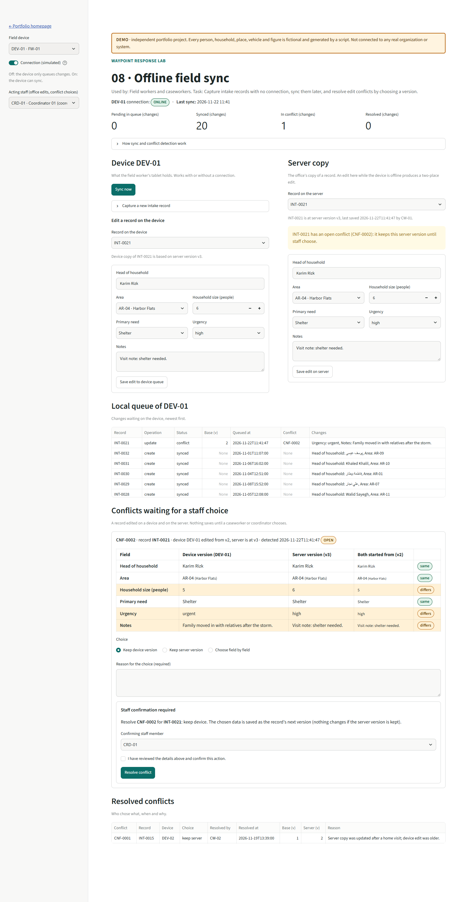

# 08 · Offline field sync

## Problem

Field workers register families in places with no mobile signal. Their tablet has to keep working offline, hold new and edited intake records in a local queue, and send them when the connection comes back. Meanwhile the office may change the same record on the server. If the device's edit simply overwrote the server, the office's correction would be lost without anyone noticing. This app captures records offline, shows the queue and the last sync time, and stops any record edited in two places until a staff member has compared both versions and chosen one.

## Intended user

Field workers (capture and edit on the device) and caseworkers or coordinators (edit the office copy, resolve conflicts).

## Technique

**Rule-based version check (optimistic concurrency), a straightforward calculation.** Every intake record has a version number. A queued edit carries its **base version**, the server version the device's copy came from. At sync time:

- base version = current server version: nobody else changed the record, so the edit is saved as the next version;
- base version ≠ current server version: the record was edited in two places. The record stays exactly as it is on the server, a conflict holds both versions, and the queue row is marked `conflict`.

A conflict is closed only by a caseworker or coordinator who chooses **keep device**, **keep server** or **field by field**, gives a reason, and confirms (`ui.confirm_action` + `confirm.require_confirmation`). If the chosen data differs from the server, it is saved as a new version with origin `conflict_resolution`. Resolution is refused if the server changed again in the meantime, so a newer edit is never overwritten. Nothing is resolved automatically.

The sync rules live in `shared/sync.py`, which the Project 20 API exposes as endpoints, so the app and the API apply one set of rules. `p08_device.py` adds the device view (its copy of each record), capture and edit on the device, the office edit, and the read models for the queue, conflicts and history. No extra libraries beyond the portfolio's `requirements.txt`.

## Inputs

- Seeded tables `intake_records`, `record_versions`, `sync_devices` (DEV-01 and DEV-02 online, DEV-03 offline), `sync_queue` (DEV-03 holds 2 pending changes), `sync_conflicts` (one past conflict, CNF-0001, already resolved), `areas`, `staff`.
- What the user types: a new intake record (head of household, area, household size, primary need, urgency, notes), edits on the device copy or the server copy, the connection switch, and the conflict choice with a reason.

## Assumptions

- **The local queue lives in the shared demo database.** A real device would keep its queue and its copy of the records on the device; here `sync_queue` rows for that device play that role, and the connection switch (`sync_devices.online`) simulates losing the signal.
- **The device's copy of a record** is the record as it was at the device's last sync: the highest saved version at or before `last_sync_at` (or a version the device saved itself), with the device's still-pending edits laid on top. A second offline edit keeps the base version of the first one.
- Records captured offline get a device-scoped ID (`INT-DEV01-0001`) so they cannot collide with server IDs; the server keeps that ID, or gives the next free `INT-` number if it is taken.
- Device actions are recorded against the field worker the device is assigned to; office edits against the acting staff member in the sidebar.

## Limitations

- One device per field worker and a simulated connection; there is no real transport, retry or partial-upload handling.
- The device can only edit records it already holds (server records synced to it); records waiting in the queue as pending creates are shown in the queue but cannot be edited until they are synced.
- The device copy is derived from timestamps in the shared database. If the clock were moved backwards between syncs the derived copy could be older than expected; the version check still prevents any overwrite.
- No delete operation: queued changes are creates and updates only.

## Launch

```powershell
.\.venv\Scripts\python.exe run.py 08
# or
.\.venv\Scripts\python.exe -m streamlit run projects/08-offline-field-sync/app.py --server.port 8508
```

Port **8508**. Use your own database copy with `PORTFOLIO_DB_PATH` if other people share the default one.

## Screenshot



The image is a real capture of the page after the walkthrough steps below were performed through the same functions the app calls (device offline, edit on the device, edit on the server, connection back on, sync), so conflict CNF-0002 for INT-0021 is open and waiting for a staff choice.

## Try this demo

Start from freshly seeded data (`python -m shared.seed --reset`). The IDs come from the seed setting `demo.scenarios` -> `p08`: record **INT-0021** (at server version **v2** in the seed), device **DEV-01**, and the offline device **DEV-03**. Version numbers, IDs and field values below come from the seed's content, not from the day it ran; times shown on the page (last sync, last saved) follow the seed day and are not used in any step.

1. In the sidebar choose **Field device: DEV-01** and turn **Connection (simulated)** off. The badge shows NO CONNECTION and **Sync now** is disabled. Note the **Pending in queue** figure (the starting value) and, in the server panel, the household size and urgency of INT-0021.
2. Under **Edit a record on the device** pick **INT-0021** (the caption says the device copy is based on server version v2). Set **Urgency** to a value different from the one shown (the seed has `high`; choose `urgent`), change **Notes** to "Family moved in with relatives after the storm.", and click **Save edit to device queue**. The local queue shows a pending `update` with base version 2; **Pending in queue** is 1 higher than at the start.
3. In **Server copy** pick **INT-0021**, raise **Household size** by 1 from the value you noted, and click **Save edit on server**. The server copy is now **v3**.
4. Turn **Connection** back on and click **Sync now**.
5. **Expected result:** a warning says *0 applied, 1 conflict(s)*; **Conflicts waiting for a staff choice** shows a new conflict (**CNF-0002** on the standard seed, the next number after the one past conflict) for INT-0021 with the device version and the server version side by side and the three differing fields (household size, urgency, notes) highlighted. INT-0021 stays at **v3** with the server's data (the household size you set in step 3, the urgency you noted in step 1), the queue row is `conflict` (**In conflict** is 1, **Pending in queue** is back to its starting value), and the server panel warns that the record keeps the server version until staff choose.
6. Choose **Choose field by field** (for example household size from the server, urgency and notes from the device), type a reason, pick a caseworker or coordinator as confirming staff, and click **Resolve conflict** first without ticking the box: the page says "Tick the confirmation box first. Nothing was changed." and the conflict stays open (so it does too without a reason). Then tick the box and click again. INT-0021 is saved as **v4** with the chosen mix (the server's household size, the device's urgency and notes), and the conflict moves to **Resolved conflicts** with who chose, when and why.

Also try: choose **DEV-03** (offline, with 2 pending changes in the seed), turn its connection on and click **Sync now**: the new record `INT-DEV03-0001` is created at version 1 and INT-0030 is updated to its next version, with no conflict; **Pending in queue** falls to 0.

The screenshot above shows the page after steps 1 to 5 (open conflict, nothing resolved yet), on a database copy prepared that way; a freshly seeded database has no open conflict until you do these steps.

## Tests

`tests/test_p08_offline_sync.py` (21 tests) covers:

- offline capture queues a pending create with a device-scoped ID and `sync_device` refuses while offline;
- syncing online creates the record at version 1 and records the last sync time;
- an update whose base version matches applies without a conflict; the device copy follows its own pending edits and does not see unsynced server edits;
- the seeded DEV-03 queue syncs once the device is online;
- an offline edit plus a server edit opens a conflict, leaves the server record unchanged, and marks the queue row `conflict`;
- resolving without confirmation (none, empty, unknown staff, a field worker) raises `ConfirmationRequired` and leaves the conflict open; no reason, or an incomplete field-by-field choice, is refused;
- keep device, keep server and field by field each save the expected data and version, write `record_versions` with origin `conflict_resolution` when the data changes, mark the conflict and queue row resolved and write an audit row;
- syncing again never closes a conflict on its own (Part 4: *sync conflicts are detected and never resolved silently*);
- the app starts (`app_test(8)`), and the whole walkthrough through the app: connection off, device edit, server edit, connection on, sync, conflict shown, refused without the tick, resolved field by field with it.
