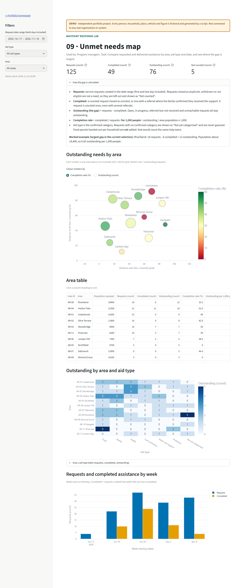

# 09 · Unmet needs map

## Problem
Program managers need to see where requests for help are not being met. Requests and completed assistance sit in different records, so the gap is hard to see by area, aid type and date.

## Intended user
Program managers.

## Technique
Straightforward calculation (counts and ratios over the shared database). The project only reads; it writes nothing. No model, no estimation.

## Inputs
- `service_requests`: created date, area, confirmed `category` (aid type), `closure_outcome`.
- `referrals`: `request_id` and `family_received`.
- `areas`: names, grid centroids (`x_km`, `y_km`) and `population_estimate`.

## Assumptions
How the gap is worked out (also shown on the page):
- **Requests**: service requests created in the date range, first and last day included. Default range: the last 30 days up to today (demo clock).
- **Not a need**: requests closed as `duplicate`, `withdrawn` or `not_eligible`. They are left out of requests and of the gap, and shown as a separate "Not counted" figure.
- **Completed**: a counted request closed as `assisted`, or one with a referral where `family_received = 1`. Each request counts once, even with several referrals.
- **Outstanding (gap)** = requests - completed, per area and aid type. Open, in progress, referred-but-not-received and unreachable requests stay outstanding.
- **Completion rate (%)** = completed / requests (blank when an area has no requests). **Per 1,000 people** = outstanding / area population x 1,000.
- **Aid type** is the confirmed category. Requests with no confirmed category appear as "Not yet categorised"; the model's suggestion is never used.
- Area-level totals only. All 12 areas always appear, with zeros where nothing happened.
- The weekly chart groups requests by the week (Monday start) in which they were created; "completed" counts those same requests that are completed now.

## Limitations
- Food parcels handed out are recorded per household round (distributions), not per request. They are **not** added to completed assistance: doing so would count the same help twice.
- Completion is only what is recorded: a request closed "assisted" or a referral confirmed by the family. Help received but not recorded shows as outstanding.
- A request is dated by when it was created, so a request created before the range but completed inside it is not counted.
- Area totals hide differences inside an area. Map positions are on an invented 100 x 100 km grid, not real places.
- Marker size is outstanding + 0.5 so that areas with no gap stay visible as small dots.

## Launch
```powershell
.\.venv\Scripts\python.exe run.py 9
# or
.\.venv\Scripts\streamlit.exe run projects/09-unmet-needs-map/app.py --server.port 8509
```
Port 8509.

## Screenshot


## Try this demo
Start from freshly seeded data (`python -m shared.seed --reset`) and run `python run.py 9`. The seeded requests are dated relative to the seed time, so the counts differ from day to day; every statement below is a relationship that holds on any day. Read each starting value from the page, where it is named.

1. Open the page. In the sidebar the date range is the last 30 days, ending on the date shown in the "Demo clock" caption (both days included). Read the four metrics: **Requests**, **Completed**, **Outstanding** and **Not counted**. Outstanding equals Requests minus Completed. In the **Area table**, the 12 areas' requests, completed and outstanding figures add up to the same three metrics (Not counted adds up too), and the table is sorted by outstanding, largest first.
2. Open **How the gap is calculated**. Its worked example names the area in the first row of the area table and repeats that row's figures: "N requests - C completed = G outstanding", with the area's population and outstanding per 1,000 people.
3. Set **Aid type** to **Food**. Requests, completed and outstanding are now the food subset (each no larger than in step 1) and Outstanding still equals Requests minus Completed. The worked example now reads "N food requests - C completed = G outstanding" for the area at the top of the table; that area's marker is the biggest on the map, and the Food column of the area x aid type heatmap shows the same G for it. (Check on any day: the aid types, including **Not yet categorised**, add up to the all-aid-types metrics.)
4. Set **Aid type** to **Not yet categorised**: Completed is 0 and Outstanding equals Requests, because in the seed every uncategorised request is still `new` (none is closed or referred).
5. Set the aid type back to all and **Area** to the area that was in the first row in step 1: the metrics equal that area's row of the unfiltered table, and the weekly chart shows its requests and completed counts by week (Monday start).

Observed on two copies seeded five days and several hours apart: the metrics differed between them (for example requests 124 on both but completed 48 versus 50, outstanding 76 versus 74), while every relationship above held on both.

## Tests
`tests/test_p09_unmet_needs.py` covers: the gap per area and aid type on hand-built requests (assisted, a referral received counted once with two referrals, duplicate / withdrawn / not eligible excluded, open and unreachable outstanding, no-category requests as their own aid type); inclusive date boundaries; aid type and area filters; all 12 areas present with zeros; area totals summing to the overall totals; the per-1,000 figure; the default 30-day range; and the app starting with and without data.

No extra libraries beyond `requirements.txt`.
