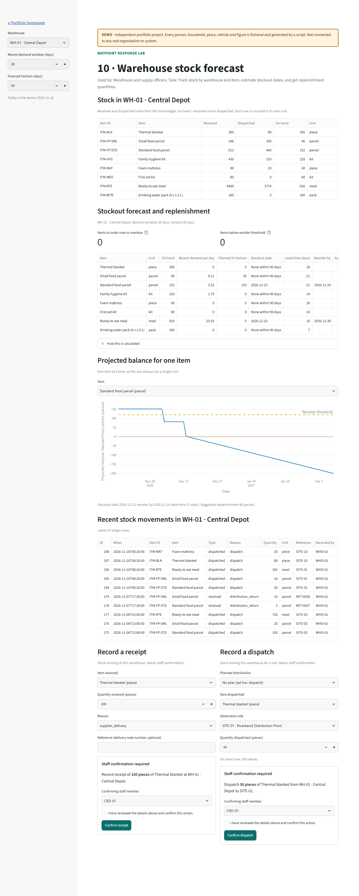

# 10 · Warehouse stock forecast

## Problem

A warehouse officer must know what is on hand, how fast it is leaving, and when each item will run out, early enough to reorder before the delivery lead time makes it too late. This tool tracks stock received, dispatched and on hand by warehouse and item, and uses recent demand, planned distributions and delivery lead times to estimate stockout dates and suggest replenishment quantities.

## Intended user

Warehouse and supply officers (and coordinators who approve stock movements).

## Technique

Straightforward calculation: a day-by-day projection of the stock balance. No statistical model.

## Inputs

- The stock ledger `stock_movements` (read through `shared.stock` / view `v_stock_on_hand`): the only source of on-hand stock.
- `distribution_plans` (written by Project 11): planned quantity per warehouse, item and date.
- `item_lead_times`: lead time, safety days and reorder threshold per warehouse and item.
- Visible inputs in the sidebar: warehouse, recent-demand window (default 28 days) and forecast horizon (default 90 days).

## Assumptions

- **Recent demand per day** = (ledger `dispatched` minus `received` with reason `distribution_return`, over the window of days before today) divided by the window length. Never below zero. Movements dated today are not in the window.
- **Planned distributions** = plans with status `planned`, planned date today or later, and no dispatch row. Each plan's quantity is demand on its date at its warehouse for its item.
- **No double counting** (a planned distribution is the same activity as the demand it will cause): for a warehouse-item pair, from today up to and including its last planned date the daily demand is the planned quantities only (zero on days without a plan). After the last planned date, and for pairs with no plans, the recent daily demand is used.
- **Stockout date** = first day within the horizon on which the projected balance goes below zero (that day's demand cannot be fully met). A balance of exactly zero is not a stockout. Otherwise "None within N days".
- **Reorder by** = stockout date minus the lead time. "ORDER NOW / OVERDUE" when that date is today or earlier.
- **Suggested replenishment** = projected demand over (lead time + safety days + 28 days) minus on hand, never below zero, rounded up to the next 10.
- **Below threshold** = on hand lower than the item's reorder threshold.
- Every quantity is in its item's unit (parcel, meal, kit, piece, pack). Different items are never added together and a chart shows one item at a time.

## Limitations

- Demand outside planned distributions is the flat recent average; no seasonality, trend or uncertainty range.
- Stock already on order is not tracked (there is no purchase-order table), so suggested replenishment does not subtract incoming deliveries.
- A dispatch against a plan marks the whole plan dispatched even if the dispatched quantity differs from the planned one.
- Receipts are limited to the reasons `supplier_delivery` and `transfer_in`. Returns (Project 12) and write-offs are not entered here.
- No extra library beyond the portfolio's `requirements.txt`.

## Launch

```
python run.py 10
streamlit run projects/10-warehouse-stock-forecast/app.py --server.port 8510
```

Port 8510.

## Screenshot



## Try this demo

The seeded dates move with the seed's anchor, so steps use relative dates. Values below are for the standard seed with the demo clock at its anchor day ("today"). Pick warehouse **WH-01 · Central Depot** in the sidebar.

1. **Received minus dispatched equals on hand.** In the stock table find *Standard food parcel* (`ITM-FP-STD`, unit parcel). Expected: received 612, dispatched 460, on hand 152 (612 - 460 = 152).
2. **Stockout date and replenishment.** In the forecast table, same row. Expected: planned in horizon 150 parcels (two open plans, `PLN-0051` 70 parcels about 19 days ahead and `PLN-0057` 80 parcels about 28 days ahead), recent demand 3.32 parcels per day, stockout date today + 29 days, reorder by today + 8 days (lead time 21 days), suggested replenishment 90 parcels, not flagged below threshold (on hand 152 is above the threshold of 120). The "How this is calculated" box explains each column. The chart (item *Standard food parcel*) shows the balance falling in steps on the two plan dates, then sloping down at the recent rate until it crosses zero.
3. **Record a receipt.** Under "Record a receipt" choose *Standard food parcel*, quantity 100, reason supplier_delivery, tick the confirmation box and press "Confirm receipt" as a warehouse officer or coordinator (for example `WHO-01`). Expected: a green message, on hand 252 (712 received), the new movement at the top of the ledger list, the stockout date moves to today + 59 days, reorder by today + 38 days, suggested replenishment 0. Without the tick, or as another role, nothing is recorded.
4. **Dispatch against a plan (optional).** Under "Record a dispatch" choose plan `PLN-0051`, confirm. Expected: on hand drops by 70, the plan is marked dispatched and disappears from the plan list and from planned demand.

## Tests

`tests/test_p10_stock_forecast.py` (run `python -m pytest tests/test_p10_stock_forecast.py`) covers: stock balances by warehouse and item (received minus dispatched equals on hand from the view and from the stock table; dispatch rows equal ledger dispatches); recent demand (net of returns, window edges, today excluded, never negative); plan selection (status, date, already-dispatched plans excluded); the no-double-counting rule; stockout date with a hand-built known answer, none-in-horizon and exact-zero cases; reorder-by and the order-now flag; replenishment rounding; below-threshold flag; a future plan changing the forecast; receipts and dispatches (on hand changes, plan marked dispatched, audit rows, refused without confirmation or for the wrong role, dispatch beyond on hand refused); and the app starting and recording a receipt and a dispatch through its confirmation forms.
