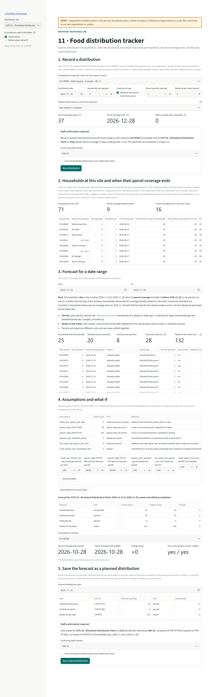

# 11 · Food distribution tracker

## Problem

A distribution site hands out food parcels and ready-to-eat meals to households. The team needs to record each handover,
know when each household's food is expected to run out, and plan the next round: how many households will be due at a
site in a coming period, how many parcels to request, and how many ready-to-eat meals. Parcels and individual meals are
different units, so they must be counted separately. The planning assumptions (how long a parcel lasts, how many meals a
person eats) change, and planners need to see how a change moves the forecast before they adopt it.

## Intended user

Distribution site supervisors and field workers recording handovers; coordinators who adjust the assumptions and turn
the forecast into a planned distribution for the warehouse.

## Technique

**Straightforward calculation** (rule-based forecasting). Coverage days and coverage end dates come from the shared
module `shared/food.py`; the forecast applies a documented due-date rule and parcel and meal rules per household.

## Inputs

- `households` (active households only: size, area, registration date) and `sites` from the shared database.
- `distributions`: date, site, household, household size, parcel type, `parcel_quantity` (parcels),
  `rte_meal_quantity` (meals), `expected_coverage_days` (computed when recorded), optional dispatch link.
- `forecast_assumptions`: person-days per standard and small parcel, meals per person per day, people per standard
  parcel, ready-to-eat meals per person per visit.
- `dispatches` (read only, to link a distribution to the dispatch its parcels came from) and `distribution_plans`
  (read, and written by "Save as planned distribution").

## Assumptions

- **Parcel coverage days** come from parcels only (`food.parcel_coverage_days`): parcels x person-days per parcel /
  people, rounded down. This is the household's expected days of coverage and what is stored. **Meal coverage days** are
  a separate figure (`food.meal_coverage_days`): meals / (people x meals per person per day), rounded down. They are
  shown beside the parcel days and never added to them or to the coverage end date. Seeded values: a standard parcel is
  150 person-days (5 people for 30 days), a small parcel 60 person-days (2 people for 30 days), 3 meals per person per day.
- **Parcel coverage end** = distribution date + parcel coverage days - 1 (the distribution day is day 1). A household's
  coverage end is the latest end over its distributions that include parcels (a meals-only distribution gives none),
  recomputed from the stored quantities with the assumptions in use. The
  stored `expected_coverage_days` (the value at recording time) is shown beside it.
- **A household's site** for the forecast is the site of its most recent distribution; a household with none belongs
  to the site whose catchment includes its area.
- **Due for support** in a window [start, end]: the coverage end date is before the end date, so the household runs out
  of food on or before the last day of the window. Households whose coverage already ended, and households with no
  recorded distribution, are due.
- **Parcels required** (the shared rule `food.parcel_plan`, also used by the seed): households of up to 2 people get 1
  small parcel; larger households get one standard parcel per 5 people (editable), rounded up. Standard and small parcels are shown as separate counts, both in parcels.
- **Ready-to-eat meals required**: only due households registered in the last 60 days (new arrivals), household size x
  6 meals (editable). Shown in meals. **Parcels and meals are never added together** in any total, metric, table or plan.
- **Planned distributions** feed Project 10's warehouse forecast: one `distribution_plans` row per item with a quantity
  above zero (`ITM-FP-STD` and `ITM-FP-SML` in parcels, `ITM-RTE` in meals), from the warehouse that supplies the
  site, using the saved assumptions. A second plan for the same site, item and date is refused (any status except
  cancelled), so Project 10 and Project 12 never count the same distribution twice.

## Limitations

- The forecast uses each household's current registered size; a size entered at a distribution only affects that
  distribution's coverage.
- New arrivals are counted from today (registered in the last 60 days), not from the window start.
- Recording a distribution needs a staff confirmation (a field worker or coordinator ticks the confirmation box in the
  form) and is audited. Saving assumptions and saving a plan need a coordinator's confirmation.
- A second distribution for the same household on the same date is refused as a likely double entry.
- The dispatch list offers dispatches of the chosen parcel type to the site on the distribution day or the evening
  before (when the seed's stock arrives). Recording never creates dispatches or stock movements: stock is Project 10's
  ledger.
- Only sites with a household catchment (distribution points) are offered; community halls and the clinic are not food
  distribution sites in the seed.
- No fallback technique was needed. No extra libraries beyond `requirements.txt`.

## Launch

```powershell
python run.py 11
# or
streamlit run projects/11-food-distribution-tracker/app.py --server.port 8511
```

Port 8511. Run from the repository root with the virtual environment's Python.

## Screenshot



## Try this demo

The walkthrough household comes from the seed: `json.loads(db.get_setting("demo.scenarios"))["p11"]` gives
`household_id`, `household_size`, `site_id` and `current_coverage_end`. On a freshly seeded database it is a household
of 5 people whose parcel coverage ends a few days after today (with the current seed: **HH-00037** at **SITE-06 · Almond
Grove Distribution Point**, parcel coverage ending **today + 4 days**).

1. In the sidebar choose the scenario site (SITE-06). In section 2, find the household (sort by "Household" or use the
   table search). **Expected:** its coverage ends on `current_coverage_end` (today + 4 days, "Days left" 4), with 30
   stored parcel days from its last distribution 25 days ago.
2. In section 3, keep the default window (tomorrow to today + 7 days, "next week"). **Expected:** the household is
   listed as due ("ends before the window's last day", 1 standard parcel, no meals because it registered more than 60
   days ago). At SITE-06 the forecast shows 28 households due, 28 standard parcels, 6 small parcels, 34 parcels in all,
   and 120 ready-to-eat meals (a separate unit).
3. In section 1, choose the household (the size defaults to 5, the parcel type to standard, the quantity to 1, meals to
   0). **Expected preview before saving:** parcel coverage 30 days (150 / 5), meal coverage 0 (separate), expected
   coverage 30 days, coverage ends **today + 29 days**. Press **Record distribution** in the staff confirmation form (choose the confirming staff member, tick the box).
4. **Expected:** a confirmation with the new distribution ID and "30 days of coverage, ending today + 29". In section 2
   the household's coverage end is today + 29 days ("Days left" 29, stored days 30). In section 3 it is no longer in next
   week's forecast: 27 households due and 27 standard parcels (one fewer, the household's parcel), small parcels (6)
   and meals (120) unchanged.

To see the assumptions at work: in section 4 change `person_days.ITM-FP-STD` from 150 to 120 and press "Show the
effect". At SITE-06 for next week (fresh database) the comparison shows households due 28 → 33, standard parcels
28 → 36, small parcels 6 → 6 and meals 120 → 144. Saving the edited values or saving a plan (section 5) asks for a
coordinator's confirmation; saving a plan twice for the same site, item and date is refused.

## Tests

`tests/test_p11_food_distribution.py` (24 tests):

- Parcel coverage and coverage end dates by household size (1 standard parcel: 5 people 30 days, 3 people 50 days,
  6 people 25 days; 1 small parcel for 2 people 30 days), meal days kept separate from parcel days, coverage stored at recording.
- Edited assumptions (`person_days.ITM-FP-STD` = 120) change coverage, the coverage end date and the forecast; saving
  assumptions refuses without a coordinator's confirmation, validates values, updates `updated_at`/`updated_by` and audits.
- Parcels and ready-to-eat meals never summed: forecast summary fields and units, all parcels = standard + small only,
  per-item plan quantities in their own units.
- The walkthrough end to end with the `p11` scenario: due before recording, not due after, coverage end = today + 29.
- Due-window edges (coverage ending on the last day vs the day before), site assignment (last distribution, then
  catchment), merged households excluded, parcels-required rule for sizes 1, 2, 3, 5, 6, 10, meals for new arrivals only
  (including the 60-day edge).
- Recording guards (no quantities, non-food site, future date, wrong dispatch, same-day double entry), dispatch link,
  no stock movements created.
- Saving a plan writes one `distribution_plans` row per item with correct units, warehouse and households, needs
  confirmation, is audited, and refuses a duplicate or a seeded existing plan and past dates.
- `app_test(11)` starts without an exception; recording the walkthrough parcel through the app needs the confirmation and writes the row; recording without a valid confirming staff member is refused.
