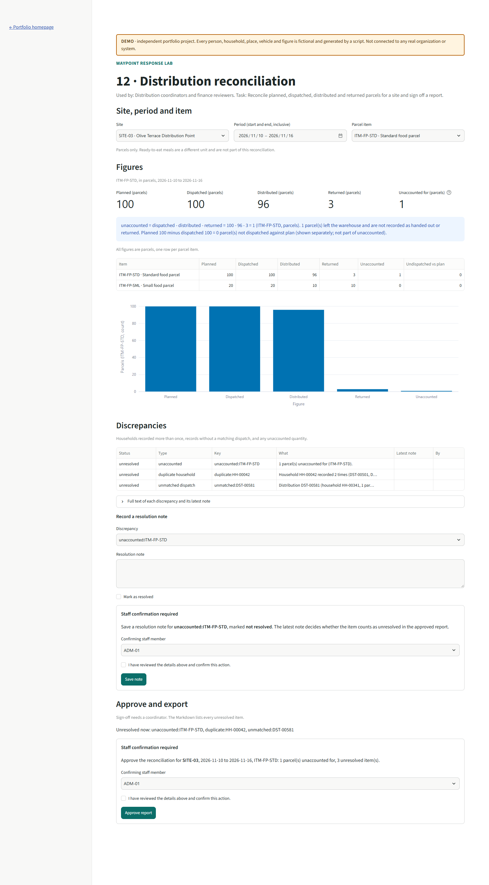

# 12 · Distribution reconciliation

## Problem
After a distribution round, the numbers rarely agree: parcels were planned, dispatched from the warehouse, handed to households and some came back. Finance reviewers need to see what is unaccounted for and why, before they sign anything off.

## Intended user
Distribution coordinators and finance reviewers.

## Technique
Straightforward calculation with rule-based flags (no model). For one site, one parcel item and a period (dates inclusive):

- planned = sum of `distribution_plans.planned_quantity` in the period, cancelled plans excluded
- dispatched = sum of `dispatches.quantity` to the site for the item (by dispatch date)
- distributed = sum of `distributions.parcel_quantity` at the site for the item; every row counts, including flagged ones
- returned = sum of `distribution_returns.quantity` at the site for the item (by return date)
- **unaccounted = dispatched - distributed - returned** (negative means more was handed out than dispatched)

"Not dispatched against plan" (planned - dispatched) is shown separately and is not part of unaccounted. Flags: a household with more than one distribution row for the same item in the period (`duplicate:<household_id>`); a distribution row with no dispatch, or a dispatch for another site or item (`unmatched:<distribution_id>`); and the unaccounted quantity itself (`unaccounted:<item_id>`).

## Inputs
Seeded tables `distribution_plans`, `dispatches`, `distributions`, `distribution_returns`, plus `reconciliation_notes` and `reconciliation_reports` (written by this project). The four figures are read from their own tables, not from `stock_movements`: a return also appears there as a receipt and would be counted twice.

## Assumptions
- Parcels only (`ITM-FP-STD` and `ITM-FP-SML` are reconciled separately, never added together). Ready-to-eat meals are a different unit and are not part of this reconciliation.
- The latest note for a discrepancy decides whether it is resolved.
- Notes are keyed by site, period and discrepancy key (not by item), so a household flagged for both parcel items shares one note thread.
- Saving a note needs a confirming staff member (any active staff; ticked confirmation form, audited), because a resolved note changes what the report lists as unresolved. Sign-off needs a coordinator (or admin) to confirm.

## Limitations
- Matching is by IDs only: a distribution row is "unmatched" if it has no dispatch or its dispatch is for another site or item; quantities are not compared line by line.
- One site, one item and one continuous period per report.
- Local demo mode: a sidebar selector stands in for sign-in.

## Launch
```
python run.py 12
streamlit run projects/12-distribution-reconciliation-report/app.py --server.port 8512
```
Port 8512.

## Screenshot


## Try this demo
The page opens on the seeded scenario (`demo.scenarios` -> `p12`), which names the site, item, period and the two flagged records. The period is always the seven days from 12 to 6 days before the demo date, so its dates move with the seed; the parcel figures below are fixed by the seed's content and are the same whatever the date.
1. Open the page. The site `SITE-03`, the period (read it in the "Period" box) and item `ITM-FP-STD` are already selected. The figures show 100 planned, 100 dispatched, 96 distributed, 3 returned and **1 parcel unaccounted for**. The explanation reads `unaccounted = dispatched - distributed - returned = 100 - 96 - 3 = 1`.
2. In the discrepancy list see three flags: `unaccounted:ITM-FP-STD`, `duplicate:HH-00042` (household HH-00042 recorded twice, 3 parcels in total) and `unmatched:DST-00581` (household HH-00341, no dispatch recorded). The scenario names the same two households (`duplicate_household_id`, `unmatched_household_id`); the two distribution IDs shown in the "What" column of the table are the ones to read from the page.
3. Add a resolution note to the duplicate and to the unmatched record, tick "Mark as resolved" for each, tick the confirmation box and press "Save note"; leave the unaccounted parcel without a note. **Expected:** the two rows change to "resolved" and "Unresolved now" lists only `unaccounted:ITM-FP-STD`.
4. Choose a coordinator or admin in "Confirming staff member", tick the box and press "Approve report". **Expected:** "Report RCN-... approved by ..." (the number is the next free report ID) with a download button.
5. Download the Markdown. **Expected:** it states the period and the four figures, the formula `100 - 96 - 3 = 1`, each discrepancy with its latest note, and its "Unresolved items" section lists only `unaccounted:ITM-FP-STD`.

## Tests
`tests/test_p12_reconciliation.py`: the 100/96/3 scenario gives 1 unaccounted; zero activity, negative unaccounted, inclusive period boundaries, cancelled plans, other items and sites, the ledger not being used, meals not mixed with parcels; duplicate and unmatched detection on the seed and on hand-built rows; notes (latest decides, audited, validated); approval refused without confirmation, report written with the exact unresolved keys; the app starts without error; the walkthrough through the app (notes, approval refused without the tick box, exported Markdown).
