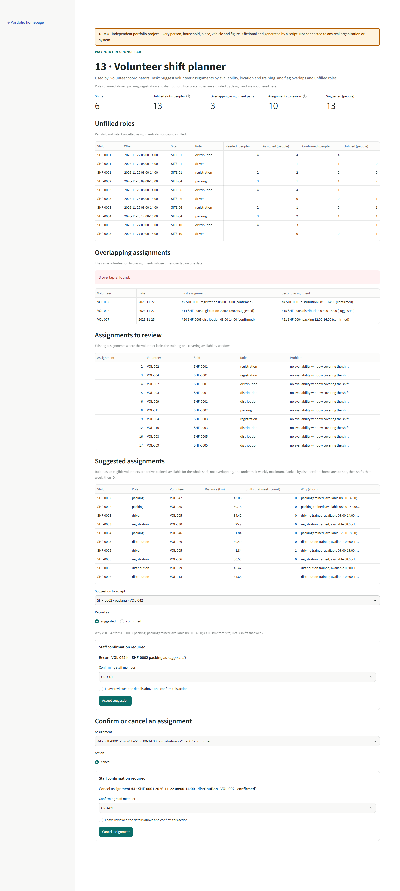

# 13 · Volunteer shift planner

## Problem
Coordinators fill shifts (drivers, packing teams, registration staff, distribution volunteers) by hand. It is easy to put one volunteer on two overlapping shifts, to send someone without the right training, or to miss a role that is still empty.

## Intended user
Volunteer coordinators.

## Technique
Rule-based scoring (no model). For each unfilled role slot a volunteer is eligible when they are active, have the required training, have an availability window on the shift date that covers the whole shift, are not already assigned (suggested or confirmed) to an overlapping shift, and are under `max_shifts_per_week` for that ISO week (Monday to Sunday). Eligible volunteers are ranked by distance from their home area centroid to the site (`shared.geo.distance_km`, invented grid), then by shifts already that week, then by volunteer ID, so results are deterministic. Slots are filled greedily and a suggestion never creates an overlap or exceeds the required count. Every suggestion shows why: training, availability window, distance in km, shifts that week.

Flags: overlapping assignments (same volunteer, same date, overlapping times, any non-cancelled status, including two roles on one shift), unfilled roles (required count minus non-cancelled assignments) per shift and role, and existing assignments whose volunteer lacks the training or a covering availability window.

Interpreter roles are excluded by design: the database only allows driver, packing, registration and distribution, and the app never offers an interpreter role.

## Inputs
Seeded database tables `volunteers`, `volunteer_trainings`, `volunteer_availability`, `shifts`, `shift_roles`, `shift_assignments`, plus `areas`, `sites` (grid positions) and `staff`. Volunteers are IDs only. No sample files.

## Assumptions
- Weekly maximum counts distinct non-cancelled shifts in the shift's ISO week.
- Distance is straight-line on the invented grid times the 1.3 winding factor in `shared.geo`; no travel time.
- Back-to-back shifts (one ends when the next starts) do not overlap.
- Any coordinator can confirm; local demo mode has no accounts (the confirmation form asks which staff member confirms).

## Limitations
- Greedy filling is not an optimal assignment; an earlier slot can take a volunteer a later slot needed.
- Languages are not used (interpreters are out of scope).
- The seed deliberately contains assignments that fail the availability check (shown under "Assignments to review") and a volunteer holding two roles on one shift (counted as an overlap).
- No fallback is used; nothing depends on a network or model.

## Launch
```
python run.py 13
streamlit run projects/13-volunteer-shift-planner/app.py --server.port 8513
```
Port 8513.

## Screenshot


## Try this demo
Use a freshly seeded database. Day numbers are relative to the seed date.
1. Open the page. Expected: 6 shifts, 13 unfilled role slots (people), 3 overlapping assignment pairs, 10 assignments to review, 13 suggestions available. In "Overlapping assignments" VOL-007 appears on day +3: SHF-0003 distribution (08:00-14:00) and SHF-0004 packing (12:00-16:00), both confirmed. (The other two pairs are VOL-002 holding two roles on one shift.)
2. Under "Confirm or cancel an assignment" choose `#21 · SHF-0004 ... packing · VOL-007 · confirmed`, action cancel, pick a coordinator (for example CRD-01), tick the box and press "Cancel assignment". Expected: "Assignment #21 cancelled."; overlapping pairs 3 to 2 (VOL-007 no longer listed); SHF-0004 packing goes from 1 to 2 unfilled; unfilled total 13 to 14.
3. In "Suggested assignments" choose `SHF-0004 · packing · VOL-046` (1.84 km from the site, 0 of 3 shifts that week). Record as suggested, confirm with a coordinator and press "Accept suggestion". Expected: "Recorded VOL-046 for SHF-0004 packing as suggested."; unfilled total 14 to 13; SHF-0004 packing unfilled 2 to 1. VOL-007 is not offered for SHF-0004 because that volunteer is still on the overlapping SHF-0003.
4. Without a staff confirmation (tick box unticked) nothing changes. Every change appears in `audit_log` with channel `app:13`.

## Tests
`tests/test_p13_shifts.py` covers: eligibility on hand-built cases (training, availability covering the whole shift, overlap, adjacent shifts, cancelled assignments, weekly maximum, inactive), ranking and the reasons text, suggestions that never overlap or exceed the required count and are deterministic, the planted VOL-007 overlap, unfilled counts per role on the seed, flagged invalid assignments, confirm and cancel refused without a coordinator and audited with one, accept re-checking eligibility, no interpreter role anywhere, and the app starting without exceptions.

No extra libraries beyond `requirements.txt`.
