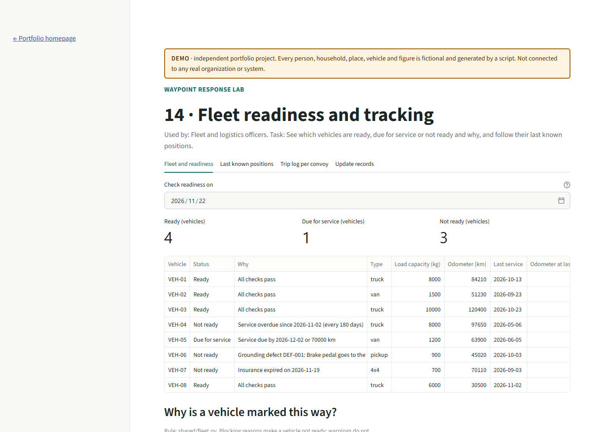

# 14 · Fleet readiness and tracking

## Problem

Before a convoy leaves, the fleet officer has to know which vehicles may be sent, which are close to a service, and which must stay behind and why. While a convoy is out, they also need each vehicle's last known position, and a warning when a vehicle has gone quiet.

## Intended user

Fleet and logistics officers (coordinators, duty officers and warehouse officers confirm updates; coordinators and admins change the stale limit).

## Technique

Rule-based scoring and straightforward calculation. Readiness is the documented rule in `shared/fleet.py` (`fleet_readiness`), which this app only calls and never redefines: a vehicle is not ready when its service is overdue by date or distance, when registration, insurance or permit has expired on the selected date, or when it has an unresolved grounding defect. It is due for service (still usable) within 14 days or 500 km of the service point. A major defect is a warning only. Staleness is `shared.fleet.is_stale`: older than the limit is stale, exactly at the limit is not, and no report at all is stale.

## Inputs

- Database tables `vehicles`, `vehicle_defects`, `drivers`, `position_reports` (read through the view `v_last_position`), `convoys`, `convoy_vehicles`, `convoy_events` (seeded, fictional).
- Setting `stale_position_minutes` (default 15), shared with Projects 17 and 20.
- Position reports are not entered here. They arrive from the Project 20 API and simulator, which write through `shared.fleet.record_position`. This app only reads them.
- The date to check readiness on (default: today in the demo clock).

## Assumptions

- Fleet numbers such as VEH-01 are fictional (not plates). Positions are kilometres on the invented 100 x 100 grid; there are no map tiles.
- "Now" is `shared.clock.now()`. The seed places position reports just before the moment it was built, so a database built long ago shows everything stale. Reseed to get a fresh demo.
- Recording a service sets last service date and odometer, and may raise the odometer but never lower it.

## Limitations

- No simulator and no API here; those belong to Project 20. Without them running, positions only change when something writes a report.
- The positions panel refreshes every 30 seconds and has a Refresh button; it is not a push feed.
- Defect, service and limit updates are deliberately small: no editing of vehicle specs, documents or defect text.
- No fallback was needed; nothing in this project uses a model or a network.

## Launch

```
python run.py 14
streamlit run projects/14-fleet-readiness-and-tracking/app.py --server.port 8514
```

Port 8514. To use your own database copy, set `PORTFOLIO_DB_PATH` first and run `python -m shared.seed --reset`.

## Screenshot



## Try this demo

Start from a freshly seeded database. Walkthrough IDs come from the setting `demo.scenarios`, key `p14`: stale vehicle `VEH-07`, convoy in progress `CNV-002`.

1. Open **Fleet and readiness** with the date set to today. Expected: 4 ready, 1 due for service, 3 not ready.
   - VEH-04: not ready, "Service overdue since 2026-11-02 (every 180 days)".
   - VEH-05: due for service, "Service due by 2026-12-02 or 70000 km".
   - VEH-06: not ready, "Grounding defect DEF-001: Brake pedal goes to the floor; brakes unsafe."
   - VEH-07: not ready, "Insurance expired on 2026-11-19".
   (The dates are for a seed built on 2026-11-22; they move with the seed's anchor.)
2. Pick VEH-06 under "Why is a vehicle marked this way?" to see the reason in red. Move the date forward a year: vehicles that were ready now show expired documents or overdue service.
3. In **Update records**, under "Resolve a defect", choose DEF-001, tick the box and press Confirm. Expected: "Defect DEF-001 resolved."; VEH-06 now shows Ready; one audit row on channel `app:14`. Pressing Confirm without the tick box changes nothing.
4. Open **Last known positions**. Expected: VEH-07 shows STALE, about 300 minutes since its last report, tracker off; all other vehicles are fresh (a few minutes old); 1 stale vehicle.
5. In **Update records**, change the stale limit to 400 minutes and confirm as a coordinator. VEH-07 is no longer stale. Set it back to 15.
6. Open **Trip log per convoy**, choose CNV-002. Expected: events planned, approved, departed; vehicles VEH-01 (DRV-02) and VEH-02 (DRV-08); 41 position reports in time order and a route plot.

## Tests

`tests/test_p14_fleet.py` (19 tests) covers: readiness reasons for VEH-04, VEH-06, VEH-07 and VEH-05's status; a later date changes readiness; the stale flag at the limit (exactly at the limit is not stale, one second over is, no report is stale), changing `stale_position_minutes` changes the flag, with the clock frozen; positions written through `record_position` become the last position and clear the flag; the CNV-002 trip log in time order; report defect, resolve defect, record service and the stale-limit change (refused without confirmation, audited); and the app starting and resolving DEF-001 through the confirmation form.

Libraries: only those in `requirements.txt` (Streamlit, pandas, plotly).
