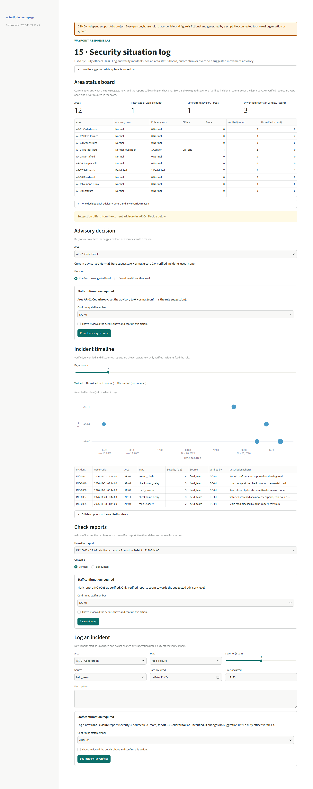

# 15 · Security situation log

## Problem
Duty officers receive incident reports from field teams, community contacts, media, a hotline and other agencies. Some are checked, many are not. They need one place that logs each report, keeps unchecked reports visibly apart from checked ones, shows the situation per area, and gives a consistent suggestion for the movement advisory level that a person then confirms or overrides.

## Intended user
Duty officers (verify, discount, decide advisories). Field staff can log reports.

## Technique
Rule-based scoring. The rule is documented and shared by Projects 15, 16 and 17 (`shared/security.py`, rule version 1):

- Only **verified** incidents count. Unverified and discounted reports are ignored.
- Look back **7 days** from now, by when the incident occurred.
- Score = sum of severity (1 to 5). Incidents in the last **48 hours** count in full (weight 1.0), older ones count half (0.5).
- Score >= 3 is level 1 Caution, >= 6 is level 2 Restricted, >= 12 is level 3 No movement, otherwise level 0 Normal.
- The duty officer confirms the suggestion or overrides it. An override needs a written reason.
- Areas at level 2 or higher block convoy stops in Project 16.

No machine learning is used. The rule is not redefined in this project; `p15_security.py` only calls it.

## Inputs
The shared SQLite database: `incidents`, `advisories` (view `v_current_advisory`), `areas`, `staff`. Seeded, fictional data only. No extra libraries beyond `requirements.txt`.

## Assumptions
- Level 0 to 3 as in the shared rule. Scores use the app clock (`shared.clock`).
- A decision stores the suggestion computed at the moment of the decision, with the rule version, score and incident IDs used. The previous active decision for the area is made inactive in the same transaction.
- A decision equal to the suggestion is a confirmation (override flag 0); any other level is an override and needs a reason.
- Only the `duty_officer` role (and admin) can verify, discount or decide. Anyone active can log a report.

## Limitations
- Local demo mode: a sidebar selector picks the acting staff member; there are no accounts.
- The suggestion is not recalculated automatically into the advisory; a person decides.
- Incident types are the six seeded ones (road closure, armed clash, unrest, shelling, checkpoint delay, crime).
- Verification is one-way: unverified to verified or discounted. There is no reopening.
- No map, no import of reports.

## Launch
```
python run.py 15
streamlit run projects/15-security-situation-log/app.py --server.port 8515
```
Port 8515.

## Screenshot


## Try this demo
Incident times in the seed are offsets before the seed time, so no date is quoted here; the scenario areas are in the setting `demo.scenarios`, key `p15` (`restricted_area_id` AR-07, `override_area_id` AR-04, `unverified_only_area_id` AR-02). The scores below are fixed by the seed's content and hold on the seed day (the 48-hour weight changes them if you open a database more than about 18 hours after it was seeded; reseed to get them back). Advisory IDs (`ADV-nnnn`) are the next free number.

1. Open the page. The status board shows 12 areas. **AR-07**: current Restricted, rule suggests 2 Restricted, score 7.0 (verified severities 4 and 3, both inside 48 hours), 2 verified and 1 unverified report. The unverified severity-5 shelling report is not counted. **AR-04**: current Normal (override with a reason), rule suggests 1 Caution (score 4.0), flagged DIFFERS. **AR-02**: current Normal, suggests 0 Normal, score 0.0, 0 verified and 2 unverified reports. Note "Differs from advisory (areas)" (1 at this point).
2. Under "Check reports", pick each unverified AR-02 report (severity 5 and severity 4), choose the outcome **verified**, choose the duty officer (DO-01 is preselected), tick the confirmation box and press "Save outcome". Expected: "INC-nnnn marked verified."
3. The board now shows AR-02 with 2 verified, 0 unverified, score 9.0 (5 + 4, both inside 48 hours), suggestion **2 Restricted**, flagged DIFFERS; "Differs from advisory (areas)" is up by 1 and the unverified count is down by 2.
4. Under "Advisory decision" choose AR-02, "Override with another level", final level 1 Caution, leave the reason empty, tick the confirmation box and press the button. Expected: the error "An override needs a written reason. Nothing was saved." and no change.
5. Enter a reason (for example "Reports checked, but the road is open and calm; hold at Caution."), tick the box and press the button again. Expected: "Recorded ADV-nnnn: AR-02 is now 1 Caution." The board shows Caution (override) with the reason, decided by DO-01, suggestion still 2 Restricted.
6. To confirm instead of override, choose "Confirm the suggested level" and confirm: "AR-02 is now 2 Restricted"; the stored final level equals the suggestion and the override flag is 0, and the area now counts under "Restricted or worse" (1 up by 1).

The timeline tabs show verified, unverified and discounted incidents in separate sections.

## Tests
`tests/test_p15_security.py` covers: thresholds just below and at 3, 6 and 12; unverified and discounted ignored; the 48-hour weight and the 7-day window; confirm (final = suggested, not an override); override with a reason becoming the current advisory and unblocking or blocking the area; override without a reason (empty, blank or none) refused with nothing written; non-duty-officers refused; decisions audited; logging an incident (validation, unverified by default, audited); verify and discount; the seed board values for AR-07, AR-04 and AR-02; verifying raising the suggestion; `app_test(15).run()` with no exception, and the walkthrough through the app (verify with the confirmation box, an override refused without a reason, then recorded with one).
