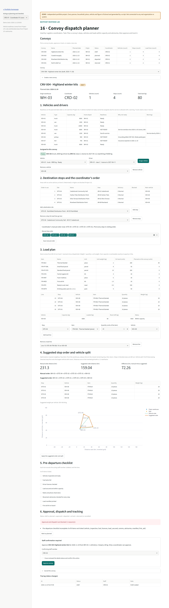

# 16 · Convoy dispatch planner

## Problem
A logistics coordinator has to send relief convoys from a warehouse to several sites. Before a convoy leaves, someone must check that every vehicle is fit to drive, that every driver may drive it, that no truck carries more than it is rated for, that the stock is really in the warehouse, and that no stop lies in an area under a movement advisory. These checks are easy to skip under pressure. This tool keeps them in one place and refuses to approve or dispatch a convoy while any of them fails, showing the reason.

## Intended user
Logistics coordinators (plan, approve, dispatch). Warehouse officers and field workers can tick checklist items and record arrival and return.

## Technique
**Optimization (nearest-neighbour heuristic) plus rule-based checks.**

- **Stop order:** start at the origin warehouse, always drive to the closest stop not yet visited, then return to the warehouse (distances from `shared.geo`: straight line on the invented grid x 1.3 road factor; ties go to the lower site ID). Stops in blocked areas are left out of the suggestion and listed with the reason. The suggestion's total distance is compared with the coordinator's manual order.
- **Vehicle split:** first-fit decreasing. Vehicles are tried largest capacity first. Stops are taken heaviest first and go whole onto the first vehicle with room. A stop that fits on no single vehicle is split by load line, then by quantity; anything left over goes on the vehicle with the most room (and shows as overloaded). Only vehicles that are not "not ready" are used. Each stop records its main vehicle (`convoy_stops.vehicle_id`).
- **Rules (not redefined here):** vehicle readiness comes from `shared/fleet.py` (Project 14: service overdue by date or distance, expired registration, insurance or permit, open grounding defect; due for service within 14 days or 500 km is a warning only). Blocked areas come from `shared/security.py` (Project 15: active advisory at level 2 Restricted or higher). Stock comes from the shared ledger (`v_stock_on_hand`) and dispatches are written with `shared.stock.record_dispatch`.
- **Project rules:** a vehicle loaded over its stated capacity is overloaded (exactly at capacity is fine). A driver must be active with a licence not expired on the planned date; trucks need class C (class B allows van, pickup and 4x4). A driver drives one vehicle per convoy, and a vehicle or driver cannot be on two open convoys on the same date.

## Inputs
The shared SQLite database: `convoys`, `convoy_vehicles`, `convoy_stops`, `convoy_loads`, `convoy_checklist`, `convoy_events`, `vehicles`, `vehicle_defects`, `drivers`, `sites`, `areas`, `warehouses`, `items` (`unit_weight_kg`, `unit`), `stock_movements` (view `v_stock_on_hand`), `advisories` (view `v_current_advisory`), `dispatches`, `staff`, `audit_log`. Fictional seeded data only. No libraries beyond `requirements.txt` (Streamlit, pandas, Plotly).

## Assumptions
- Approval checks readiness and driver licences on the convoy's **planned date**. Departure checks them again on the **day of departure** (the app clock), together with every other blocker.
- Approval and departure are refused while any of these is true, and every reason is listed: no vehicles, stops or load lines; a vehicle not ready; a vehicle overloaded; a driver who may not drive the vehicle; a stop in a blocked area; a stop with no load; more stock planned than the origin warehouse holds (summed per item across the convoy); a pre-departure checklist item not ticked.
- Assigning a vehicle marked not ready is refused at once with the readiness reasons. A vehicle can still become not ready after it is assigned (a new defect, a date passing); that is caught at approval and at departure.
- Overloading is allowed while planning so the coordinator can see it, but it is flagged in red and blocks approval. Adding a load line that would take more stock than is on hand is refused.
- Approval, dispatch and cancellation need a coordinator's confirmation (`ui.confirm_action` in the page and `confirm.require_confirmation(..., ("coordinator",))` in the domain function; admin is also accepted by the shared helper).
- Status order: draft, planned, approved, departed, arrived, returned (cancelled from draft, planned or approved). A draft can be approved directly. Each change writes `convoy_events`, sets the timestamp on `convoys`, and is audited on channel `app:16`. The plan is locked once approved.
- Departure writes one dispatch and one stock ledger row per load line, all at the same time, so on-hand stock falls by exactly the loaded quantities. A convoy that has already departed (such as seeded CNV-002) can never be dispatched again.
- The manual order is the coordinator's visiting order; new stops are appended to it. "Apply the suggested order and split" makes the suggestion the order in use and keeps the manual order for comparison. It is refused while a stop in a blocked area remains: the coordinator removes that stop first (its load lines go with it).
- Units stay with their item (parcels, meals, kits, pieces, packs); only kilograms are added up across items.

## Limitations
- **Fallback:** the stop order uses a nearest-neighbour heuristic instead of a full route optimizer (no optimization library is in the stack). It is fast and explainable but not always the shortest; the page says so when the manual order is shorter (for example SITE-02, SITE-04, SITE-03 on the walkthrough convoy is 125.62 km against the suggestion's 125.96 km).
- One trip per convoy: every vehicle leaves the warehouse and returns; the distance is for the route as a whole, not per vehicle.
- Stock planned on other approved convoys that have not left yet is not reserved; the stock check runs again at departure.
- Distances are straight lines on the invented grid times 1.3, not roads.
- Local demo mode: a sidebar selector picks the acting staff member; there are no accounts.

## Launch
```
python run.py 16
streamlit run projects/16-convoy-dispatch-planner/app.py --server.port 8516
```
Port 8516.

## Screenshot


The screenshot shows CNV-004 part way through planning: one vehicle assigned, stops and load lines entered, no checklist item ticked yet, so the blocker list is still showing. The stops and quantities are an example, not the ones in the walkthrough below.

## Try this demo
Reset the demo data first (homepage reset, or `python -m shared.seed --reset`). Dates in this database follow the day the seed runs, so the steps below name records by ID and describe results by what changes, never by a calendar date. The scenario IDs are in the setting `demo.scenarios`, key `p16`. Distances and weights depend only on the invented grid and the items, and the starting stock is fixed by the seed, so those figures are the same whatever day the data is generated (checked on two seeds five days and a different time of day apart).

1. Open the page. **CNV-004 · Highland winter kits** (status draft, origin WH-03; its planned date is shown under the convoy name) is selected. It has no vehicles. Under "6. Approval, dispatch and tracking" the blocker list shows "No vehicles assigned", "No destination stops", "No load lines" and an unticked checklist.
2. Under "1. Vehicles and drivers", choose vehicle **VEH-04** (marked NOT READY in the readiness table; the reason is under "Why a vehicle is not ready, and warnings" just below it) and driver DRV-01, then press **Assign vehicle**.
   **Expected:** the assignment is refused and a red message appears. It names VEH-04 and the convoy's planned date, and says the service is overdue (since a date earlier than the planned date, with the service interval in days). Nothing is assigned: "Vehicles (count)" stays 0 and the vehicle is not listed under "Assigned to this convoy". VEH-06 is refused the same way (it names grounding defect DEF-001) and VEH-07 too (expired insurance).
3. Choose **VEH-08** (truck, 6000 kg, Ready) with **DRV-07** (class B): refused, a truck needs class C. With **DRV-06**: refused, the licence has expired. With **DRV-01** (class C): "Assigned VEH-08 with DRV-01."
4. Under "2. Destination stops", add **SITE-04**, then **SITE-02**, then **SITE-03**. The manual order is SITE-04 → SITE-02 → SITE-03.
5. Under "3. Load plan", add these lines, all on VEH-08: SITE-04 80 ITM-BLK (blankets) and 10 ITM-HYG (hygiene kits); SITE-03 60 ITM-BLK and 15 ITM-MAT (mattresses); SITE-02 40 ITM-BLK, 20 ITM-HYG and 15 ITM-MAT. VEH-08 now carries **660 kg of 6000 kg** (5340 kg room left, within capacity). These lines use all of WH-03's hygiene kits (30) and mattresses (30); read the "On hand" column. Trying to add 1 more hygiene kit is refused: "Not enough Family hygiene kit at the origin warehouse: this line would bring the convoy to 31 kits, only 30 kits on hand."
6. Under "4. Suggested stop order and vehicle split": manual order WH-03 → SITE-04 → SITE-02 → SITE-03 → WH-03 is **200.82 km**; suggested order WH-03 → SITE-02 → SITE-03 → SITE-04 → WH-03 is **125.96 km**; difference **74.86 km**. The split puts all 660 kg on VEH-08. Press **Apply the suggested order and split**; the stop table now follows the suggested order.
7. Under "5. Pre-departure checklist", tick all 8 items (each records the acting staff member and time). The blocker list turns into "No blockers".
8. Under "6. Approval", choose confirming staff **CRD-02** and press **Approve convoy** without ticking the box: "Tick the confirmation box first. Nothing was changed." Tick the box and press again: "CNV-004 approved by CRD-02."
9. Tick the box under the dispatch confirmation and press **Dispatch convoy**: seven dispatches are recorded (one per load line). Compare "On hand" for WH-03 before and after: blankets fall by 180, hygiene kits by 30 and mattresses by 30 (exactly the loaded quantities), so hygiene kits and mattresses reach 0. Then press **Mark arrived** and **Mark returned**; the trip log shows draft, approved, departed, arrived, returned.

Blocked stop: select **CNV-003 · Coastal resupply**. Stop SITE-09 is flagged: "SITE-09 Saltmarsh Distribution Point is in AR-07 Saltmarsh, which has an active level 2 Restricted movement advisory". The suggestion leaves it out (SITE-02 → SITE-08, 103.42 km against the manual 154.46 km, which includes the blocked stop) and approval is blocked until the stop is removed.

## Tests
`tests/test_p16_convoy.py` (40 tests) covers: exactly at capacity is not overloaded and one kg over is (pure rule and on the database); approval and departure refused while a vehicle is overloaded; assigning VEH-04 (service overdue), VEH-06 (grounding defect) and VEH-07 (insurance expired) refused with their readiness reasons, including the exact VEH-04 message; due for service allowed with a warning; approval and departure refused when an assigned vehicle becomes not ready after assignment (grounding defect inserted), with the reason; driver checks (DRV-06 expired licence, class B on a truck, one vehicle per driver, licence valid on its expiry day); CNV-003's blocked stop SITE-09 excluded from the suggestion and blocking approval until removed; nearest-neighbour order and distances on a small known case and the tie rule; suggested distance not longer than manual on the seed cases, stored on `convoys`; manual order edits; first-fit decreasing split (whole stops, split by quantity, overflow flagged); stop vehicle recorded on apply; the stock limit summed across lines and stock leaving before approval; coordinator confirmation required (missing and non-coordinator refused); incomplete checklist blocks approval; status transitions only in order, each in `convoy_events` and audited; cancelling needs confirmation and a reason; every planning write audited; departure writing one dispatch and one ledger row per load line with on-hand stock falling by exactly the loaded quantities; seeded CNV-002 never dispatched twice; the full walkthrough end to end; `app_test(16).run()` with no exception; an `AppTest` run of the "assign VEH-04" step showing the reason on the page; and CNV-003's blocked stop shown on the page.
