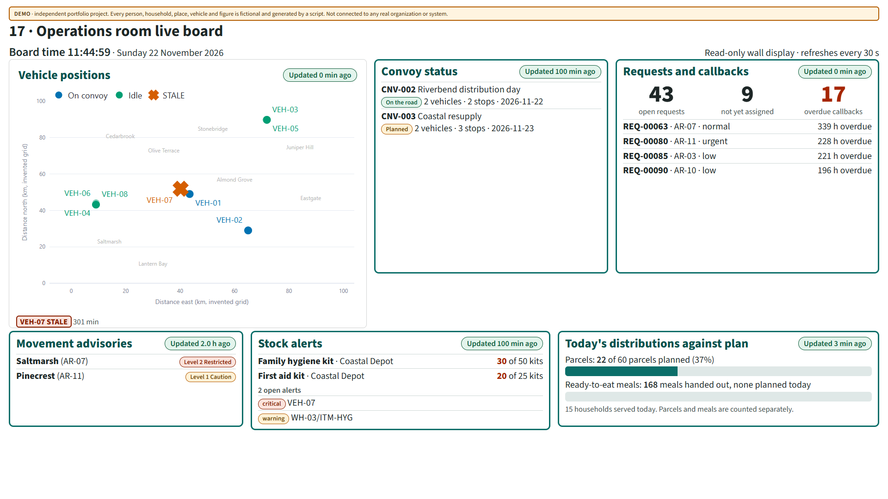

# 17 · Operations room live board

## Problem
An operations room needs one wall display that shows the whole picture at a glance and does not need anyone to click: where the vehicles are, which convoys are out, how many requests and callbacks are open or overdue, which areas have a movement advisory, what stock is low, and how today's distributions are going against plan. A wall display that silently freezes is worse than none, so every panel states when its own data last changed and turns visibly stale if its source stops reporting.

## Intended user
Operations room staff watching a screen from across the room. Nobody operates it.

## Technique
**Straightforward calculation** (counts, thresholds and age comparisons) over the shared database, refreshed with `st.fragment(run_every=...)`. No model, no writes.

- Vehicle staleness: `shared.fleet.is_stale` with the limit `shared.fleet.stale_limit_minutes` (setting `stale_position_minutes`). Exactly at the limit is not stale; just past it is.
- Panel badge: `shared.ui.freshness_badge`. A panel's "last updated" is the newest timestamp in its own source data; the panel is stale when that is older than its limit (same `is_stale` rule).
- Map: `shared.charts.grid_map` on the invented 100 x 100 km grid, no tiles. Stale vehicles are large red crosses and are also listed under the map.
- Advisories: `shared.security.current_advisories` (areas above level 0). Stock: `v_stock_on_hand` against `item_lead_times.reorder_threshold` (strictly below; at the threshold is fine). Open alerts: table `alerts`. Overdue callbacks: `shared.alerts.overdue_callbacks`.
- Distributions against plan: today's non-cancelled `distribution_plans` by item unit against `distributions.parcel_quantity` (parcels) and `distributions.rte_meal_quantity` (meals). The two are shown separately and never added.
- Time comes from `shared.clock`.

## Inputs
The shared SQLite database, read only: `position_reports` (view `v_last_position`), `vehicles`, `convoys`, `convoy_vehicles`, `convoy_stops`, `convoy_events`, `service_requests`, `request_events`, `advisories` (view `v_current_advisory`), `areas`, `stock_movements` (view `v_stock_on_hand`), `item_lead_times`, `warehouses`, `items`, `alerts`, `alert_rules`, `distribution_plans`, `distributions`, `settings` (`stale_position_minutes`, `board_refresh_seconds`). Fictional seeded data only. No libraries beyond `requirements.txt`.

## Assumptions
- The board opens the database with `PRAGMA query_only = ON`, so it cannot write even by mistake; there are no buttons, selectors or sidebar. It refreshes every `board_refresh_seconds` (30 s in the seed, never below 5 s).
- Vehicle limit: the configured `stale_position_minutes`. The map panel's own badge uses the newest report of any vehicle, so it turns stale only when the whole position feed has stopped; single vehicles are flagged individually.
- Panels fed by people rather than a feed get these limits (constants in `p17_board.PANEL_LIMIT_MINUTES`, overridable by settings, see Limitations): convoys 24 h (newest `convoy_events`), requests 4 h (newest `request_events` or request), advisories 24 h, stock and alerts 24 h (newest `stock_movements` or alert), distributions 4 h (newest `recorded_at`).
- Requests panel: "open" is every request not closed; "not yet assigned" is status `new`.
- Convoy panel lists convoys that are departed, approved or planned; a departed convoy flags its stale vehicles.

## Limitations
- Built for a 1920 x 1080 screen in a full-screen browser (F11). Type scales with the page but small screens will scroll.
- The map shows labels that can overlap when vehicles are close together. Axes are not equal-scaled (the grid is stretched to the panel).
- At most the first four rows of each list are shown so the page fits one screen.
- Limits for the human-fed panels default to the constants in `p17_board.PANEL_LIMIT_MINUTES`. A row in `settings` overrides one when it exists and is a positive number (the project never writes settings; add the row by hand or through another tool): `board_panel_limit_convoys_minutes`, `board_panel_limit_requests_minutes`, `board_panel_limit_advisories_minutes`, `board_panel_limit_stock_minutes`, `board_panel_limit_distributions_minutes`. With no row the constants apply; the seed adds none.
- Map labels: vehicle labels are drawn large; area names are small, light grey and below their point, and an area name is left out when a vehicle sits within 6 km of its centre (`p17_board.label_free_areas`). Two vehicles very close to each other can still overlap.
- The board does not start or stop the simulator; Project 20 does.

## Launch
```powershell
.\.venv\Scripts\python.exe run.py 17
.\.venv\Scripts\streamlit.exe run projects/17-operations-room-live-board/app.py --server.port 8517
```
Open http://localhost:8517 and press F11.

## Screenshot


The same board after the simulator was stopped and time moved past the limit: 

## Try this demo
Use a fresh database copy (`PORTFOLIO_DB_PATH=data/agent17.db`, `python -m shared.seed --reset`). IDs come from the setting `demo.scenarios`, key `p17`. Every statement below is relative to the moment the data was generated (every position report in the seed is at or before that moment, the newest within a few minutes of it), so it holds whatever day you seed. The stale limit is the setting `stale_position_minutes` (15 in the seed).
1. Start the board (port 8517) soon after the reset. Expected: `VEH-07` (the seeded stale vehicle, which the simulator never moves) is a red cross on the map and listed under the map as "VEH-07 STALE" with its age (hundreds of minutes, far over the limit). The other seven vehicles are not flagged. The red-bordered "critical VEH-07" alert is listed under Stock alerts. The map panel's badge reads "Updated N min ago" with N close to 0 (read it as the minutes since the newest position report).
2. Stop the position simulator through its switch: set `position_simulator_enabled` to `0` (Project 20 does this with **Stop the simulator** on its Jobs and simulator tab; the walkthrough test does it with one `UPDATE settings`). No new position arrives: a simulator step or **Run now** for `position_simulator` writes 0 rows.
3. Move time on with the frozen clock (`PORTFOLIO_FROZEN_NOW`), counting from the moment the data was generated. Expected: at +0 and +10 minutes only `VEH-07` is flagged. At +16 minutes (past the 15-minute limit for every vehicle, because none reported later than the seed moment) all eight vehicles are flagged "STALE", each named under the map with its age, convoy `CNV-002` shows `VEH-01 STALE` and `VEH-02 STALE`, and the map panel itself turns stale (dashed red border, striped grey, badge "STALE: last update N min ago" with N over 15). The rest of the board keeps working. `screenshot_simulator_stopped.png` is the real board at that moment.
4. Switch the simulator on again (**Start the simulator** on Project 20's page, or `position_simulator_enabled` set to `1`) and let one simulator run happen (**Run now** for `position_simulator` there; the scheduler does it every 60 seconds). Expected on the next refresh (30 s): the seven simulated vehicles show a report age of about 0 minutes and lose their STALE flag, `CNV-002` no longer lists stale vehicles, and the map panel's badge is back to "Updated 0 min ago". `VEH-07` stays flagged, because the simulator never moves it, and its critical alert stays.

## Walkthrough check
Run on two database copies, one seeded at the current time and one seeded with `--anchor` five days later at a different time of day (clock frozen to that anchor): the ages in step 1, the flags at +0, +10 and +16 minutes, the empty simulator step, and the clearing of the seven flags after one simulator run were the same on both (VEH-07 flagged only at +0 and +10; all eight at +16; seven cleared after step 4).

## Tests
`tests/test_p17_live_board.py` covers: a vehicle is not stale exactly at the limit and is stale one second past it; the seeded stale vehicle; the stopped-simulator walkthrough (no new rows, vehicle flagged after the limit); switching the simulator back on and one run clearing the flags (the unsimulated vehicle stays stale); a panel's freshness turning stale past its limit and every panel going stale when its source stops; the board writing nothing (row counts of key tables and `audit_log` unchanged, and a write attempt on the read-only connection fails); parcels and meals kept separate; stock alert strictly below the reorder threshold; advisories above Normal only; overdue callback counts; and the app starting (`app_test(17)`).
