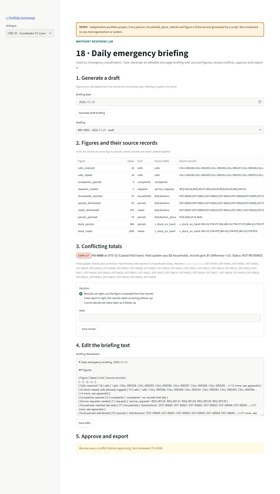

# 18 · Daily emergency briefing

## Problem
Every day the coordinator needs a one-page briefing. Field teams report numbers by message, but those numbers do not always agree with the call log, warehouse stock and distribution records. A briefing that mixes them silently is unsafe.

## Intended user
Emergency coordinators.

## Technique
Straightforward calculation and rule-based comparison (no model). Each figure is a count or sum over the records of the chosen day: calls (and the repeat calls among them), complaints opened, service requests created, distinct households and parcels and meals distributed, parcels planned, and stock on hand from `v_stock_on_hand`. Parcels, ready-to-eat meals and hygiene kits are separate figures in separate units and are never added together. **Conflict rule:** a field update with `figure_key = households_reached` and a site is compared with the number of distinct households in `distributions` for that site and day; any difference is a conflict.

## Inputs
Tables `field_updates`, `calls`, `complaints`, `service_requests`, `v_stock_on_hand`, `distributions`, `distribution_plans` (read) and `briefings`, `briefing_sources`, `audit_log` (written). Each figure is stored in `briefing_sources` with its source table and record IDs, and shown with them.

## Assumptions
- A day is the calendar date of the record's timestamp.
- Stock on hand is the current balance, not the balance at the end of the briefing day.
- Only `households_reached` is compared; other field figures (for example `household_visits`) have no matching record and are listed as text only.
- Only coordinators (or admin) review, edit and approve in local demo mode (sidebar selector).

## Limitations
- One comparison rule and exact equality, with no tolerance.
- Conflict decisions: "records are right" (resolved), "field report is right, records need correcting" and "cannot decide" (both listed as unresolved items in the export).
- Text edits change the Markdown body only; figures and sources stay as calculated.
- No extra libraries beyond `requirements.txt`.

## Launch
```
python run.py 18
streamlit run projects/18-daily-emergency-briefing/app.py --server.port 8518
```
Port 8518.

## Screenshot


## Try this demo
The page opens on the seeded conflict date (`demo.scenarios` -> `p18`).
1. Press "Generate draft briefing". A draft is created with 11 figures, each with its source table and record IDs.
2. Section 3 shows one conflict: `FU-0008` at `SITE-02` says 52 households, the records (37 `distributions` rows) give 37, difference +15. Section 5 says approval is blocked until it is reviewed.
3. Choose a decision, add a note, press "Save review". The conflict shows as reviewed.
4. Optionally edit the Markdown text and press "Save edits".
5. Tick the confirmation box, choose a coordinator and press "Approve briefing".
6. Press "Download approved briefing (Markdown)". Observed result: the file holds the figures table (18 calls, 37 households, 55 parcels, 378 meals), the conflict review with both numbers, an "Unresolved items" section (empty after "records are right", the conflict listed after "cannot decide") and an appendix with every record ID. The audit log has create, resolve and approve entries.

## Tests
`tests/test_p18_briefing.py`: figures equal independent SQL on the records; parcels and meals stay separate units; every figure has a source table and IDs; the seeded conflict (52 vs 37) is flagged and a matching figure is not; approval refused without confirmation, for an unknown or non-coordinator ID, and while a conflict is unreviewed; the export contains the approved figures, conflict review, unresolved items and appendix; approved briefings are locked; audit trail; the app starts (`app_test(18)`).
