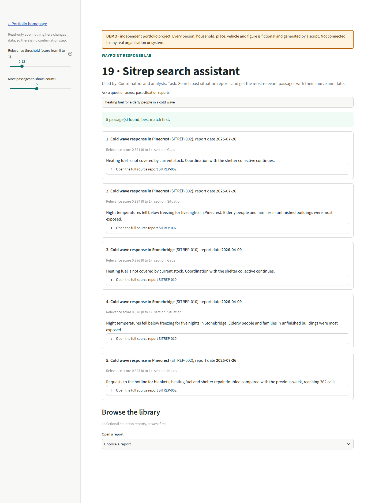

# 19 · Sitrep search assistant

## Problem
Past situation reports hold useful precedent (what was needed, what worked, what was missing), but nobody can reread 16 reports before a coordination meeting. This app lets a coordinator ask a question and see the most relevant passages, each with its source report and date. When nothing in the library is relevant it says so instead of producing an answer.

## Intended user
Coordinators and analysts.

## Technique
**Search** (lexical): a local TF-IDF index (scikit-learn `TfidfVectorizer`, English stop words, sublinear term frequency) over the 64 passages of 16 reports, ranked by cosine similarity with the question. No network, no paid API, no model download. The app never writes an answer; it only shows stored passages.

## Inputs
Tables `sitreps` (16 fictional reports: title, date, area, full text) and `sitrep_passages` (64 passages with heading and text) in the shared database. The index is built from the passage text plus its report title and heading each time the app loads (64 short passages, instant).

## Assumptions
- A passage is relevant when its cosine score with the question reaches the threshold (default 0.12, on a 0 to 1 scale; adjustable in the sidebar). The default was chosen by trying on-topic and off-topic questions on the seeded library.
- Scores are only comparable within one question.
- Library text is English. If Arabic passages are added, they are displayed right-to-left through `shared.ui.show_text`.

## Limitations
- Lexical matching only: there are no synonyms or meaning. "Chilly weather" will not find "cold wave"; "diarrhoea" will not find "disease outbreak" unless the passage uses the word.
- Question words that are not in the library at all (for example "satellite") score zero.
- Small library, so a score is a rough guide, not a probability.
- Not tuned for Arabic questions (the English stop-word list and tokenizer are used).
- Read-only app with no consequential action, so there is no staff confirmation step.

## Launch
```powershell
python run.py 19
streamlit run projects/19-sitrep-search-assistant/app.py --server.port 8519
```
Port 8519.

## Screenshot


The screenshot is the real app answering the question from step 1 below, opened with `?q=heating+fuel+for+elderly+people+in+a+cold+wave` in the address (the question box takes its starting text from the `q` query parameter).

## Try this demo
Use a freshly seeded database (`python -m shared.seed --reset`).
1. Type `heating fuel for elderly people in a cold wave`. Observed: 5 passages, best score 0.391, from "Cold wave response in Pinecrest" (SITREP-002, 2025-07-26) and "Cold wave response in Stonebridge" (SITREP-010, 2026-04-09), best first. Open "the full source report" under a passage to read the whole report.
2. Type `quantum computing satellite launch`. Observed: a warning "Nothing relevant found" and no passages.
3. Clear the box: "Type a question to search the library." Type `what is the`: a message that the question has only common words.
4. Raise the sidebar threshold to 0.5 and repeat step 1: nothing found.

## Tests
`tests/test_p19_sitrep_search.py`: a question with no relevant report returns "nothing found"; a topic in the library returns passages from the right report with its date; results are ordered by score and above the threshold; threshold behaviour; empty and common-word questions; the search writes nothing; the app starts and shows both outcomes. Extra library: none beyond `requirements.txt` (scikit-learn).
