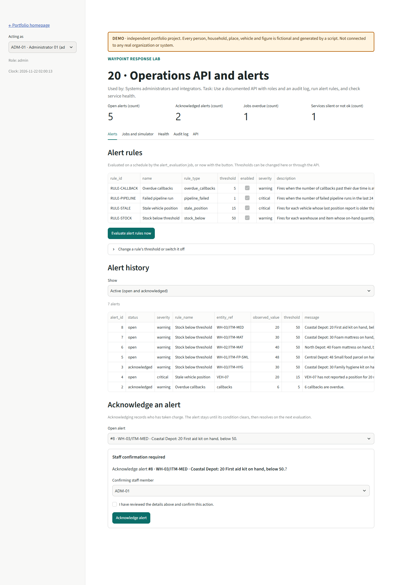

# 20 · Operations API and alerts

## Problem
An operations team runs many small tools over one database. Someone has to see who changed what, be told when stock runs low, callbacks pile up, a vehicle stops reporting or a data load fails, and check that the background jobs are still running. Other systems (vehicle trackers, field devices) need a documented way to send data in, with roles, so that not everyone can change everything.

## Intended user
Systems administrators and integrators; coordinators and duty officers who acknowledge alerts.

## Technique
Rule-based scoring (alert rules with thresholds) and straightforward calculation, plus a documented REST API (FastAPI), a job scheduler (APScheduler) and a position simulator. No machine learning.

The platform logic is in shared modules so Projects 14, 17 and server mode use the same code:

| Module | What it does |
|---|---|
| `shared/alerts.py` | Evaluates the four rule types, writes and resolves alerts, acknowledgement, rule changes, the stale limit. |
| `shared/scheduler.py` | The four jobs, `run_job` ("run now"), backups, heartbeats, `health_report`, the APScheduler setup (`python -m shared.scheduler`). |
| `shared/simulator.py` | The position simulator switch and one simulator step; last position and stale flag per vehicle. |
| `shared/auth.py` | The role table, and the server-mode staff login and API token checks. |
| `shared/api.py` | The REST API (`python -m shared.api`). |

The alert rules (table `alert_rules`, threshold editable):

| Rule | Fires when | At the threshold |
|---|---|---|
| `RULE-STOCK` stock_below | on hand < threshold, one alert per warehouse and item | does not fire |
| `RULE-CALLBACK` overdue_callbacks | overdue callbacks >= threshold (overdue: due time passed, callback not done, request not closed) | fires |
| `RULE-STALE` stale_position | minutes since a vehicle's last report > threshold, one alert per vehicle (`shared.fleet.is_stale`) | does not fire |
| `RULE-PIPELINE` pipeline_failed | failed `pipeline_ingest` job runs in the last `window_hours` (24) >= threshold | fires |

An evaluation never opens a second alert while one is open or acknowledged for the same rule and entity (for example `VEH-07`). When the condition clears, the open or acknowledged alert is marked resolved. Disabled rules are skipped. Every alert written is audited (actor `system`).

## Inputs
The shared SQLite database: `alert_rules`, `alerts`, `scheduled_jobs`, `job_runs`, `service_heartbeats`, `audit_log`, `settings`, `v_stock_on_hand`, `service_requests`, `vehicles`, `position_reports` (`v_last_position`), `convoys`, `convoy_stops`, `v_current_advisory`; the Project 07 sample exports through `shared.pipeline`; intake records and sync tables through `shared.sync`. Libraries already in `requirements.txt`: FastAPI, uvicorn, APScheduler, httpx (tests only).

## Assumptions
- Roles come from the `staff` table. Write actions and allowed roles (`shared.auth.ROLES`):

  | Action | Allowed roles |
  |---|---|
  | Report a position (`POST /positions`) | field_worker, coordinator, admin |
  | Acknowledge an alert | coordinator, duty_officer, warehouse_officer, admin |
  | Evaluate alert rules now | coordinator, duty_officer, admin |
  | Change an alert rule, settings (stale limit), simulator switch | coordinator, admin |
  | Run a job now | coordinator, admin |
  | Sync: send a device change | field_worker, coordinator, admin |
  | Sync: server edit, resolve a conflict | caseworker, coordinator, admin |

- The stale-position limit is one number: changing it here sets the `stale_position_minutes` setting (read by 14 and 17) and the `RULE-STALE` threshold together.
- A job is overdue when it has no successful run within 2 x its interval. A service is "silent" when its heartbeat is older than 5 minutes.
- The simulator moves each simulated vehicle at 40 km/h toward its next convoy stop when its convoy is departed, otherwise drifts within 0.5 km of its home warehouse. `VEH-07` is not simulated, so it goes stale. Simulator reports are not audited one by one (they are data, like seed reports); the job run records each step.
- Backups use SQLite's online backup API into `PORTFOLIO_BACKUP_DIR` (default `data/backups`), keeping the last 5 copies of each database file.

## Limitations
- Local demo mode has no background process: jobs run only when someone presses **Run now** (or starts `python -m shared.scheduler`). So right after a reset, the simulated vehicles go stale after 15 minutes until the simulator job runs, and `pipeline_ingest` shows as overdue.
- `/docs` (Swagger UI) and `/redoc` load their JavaScript and styles from a public CDN in the browser, so they do not work offline. `/reference` is a self-contained HTML page generated from the OpenAPI document (every path, method, parameter and required role) that works with no network; `/openapi.json` always works.
- Local demo mode trusts the `X-Staff-Id` header (anyone can claim a staff ID). That is acceptable for a demo; server mode adds a bearer token for every write. There is one shared API token, not one per user.
- Two apps writing at the very same moment wait for each other (SQLite write lock); fine at demo scale.
- An alert's observed value is the value when it fired; it is not updated while the alert stays open.
- The settings audit row is written by `db.set_setting` with channel `settings` and relabelled to the real channel (`app:20` or `api`) inside the same transaction; sync changes through the API are relabelled from `sync` to `api` the same way.

## Launch
```
python run.py 20
streamlit run projects/20-operations-api-and-alerts/app.py --server.port 8520
```
Port 8520. The page works whether or not the API is running; the API tab shows whether it is reachable.

API (port 8600, from the repository root with the venv's Python):
```
python -m shared.api
uvicorn shared.api:app --port 8600
```
Docs: `http://localhost:8600/reference` (offline), `http://localhost:8600/docs`, `http://localhost:8600/openapi.json`.

Scheduler (runs the four jobs on their intervals in the foreground, and writes the scheduler and simulator heartbeats; stop with Ctrl+C):
```
python -m shared.scheduler
```

Example API calls:
```
curl http://localhost:8600/health
curl -X POST http://localhost:8600/alerts/evaluate -H "X-Staff-Id: CRD-01"
curl -X POST http://localhost:8600/positions -H "X-Staff-Id: FW-01" -H "Content-Type: application/json" -d "{\"vehicle_id\": \"VEH-07\", \"x_km\": 41.5, \"y_km\": 52}"
```

Endpoints: `GET /health`, `GET /jobs`, `POST /jobs/{job_name}/run`, `GET /alert-rules`, `PATCH /alert-rules/{rule_id}`, `GET /alerts`, `POST /alerts/{alert_id}/acknowledge`, `POST /alerts/evaluate`, `GET /vehicles/positions`, `POST /positions`, `GET /simulator`, `PUT /simulator`, `PUT /settings/stale_position_minutes`, `GET /audit`, `GET /stock`, `GET /requests/overdue-callbacks`, `GET /advisories/current`, the sync endpoints `POST /sync/changes`, `GET|PUT /sync/records/{record_id}`, `GET /sync/conflicts`, `GET /sync/conflicts/{conflict_id}`, `POST /sync/conflicts/{conflict_id}/resolve`, `GET /sync/devices/{device_id}/status`, and `GET /reference`. 401 without a valid staff ID, 403 for a role that is not allowed. Every change writes `audit_log` with channel `api`.

### Server mode
Set in `.env` (never committed; `.env.example` has placeholders):

| Variable | Use |
|---|---|
| `PORTFOLIO_MODE=server` | switches on the login and token checks |
| `PORTFOLIO_STAFF_USERNAME`, `PORTFOLIO_STAFF_PASSWORD` | staff login shown by `shared.auth.require_staff_login()` on this page |
| `PORTFOLIO_API_TOKEN` | API writes need `Authorization: Bearer <token>` |
| `PORTFOLIO_BIND_ADDRESS` | address the API listens on (default `localhost`) |
| `PORTFOLIO_BACKUP_DIR` | where `db_backup` writes |
| `PORTFOLIO_DB_PATH` | the database file |

A missing value, or one still set to `change-me`, refuses every login and every token.

## Screenshot


## Try this demo
On a fresh database (`python run.py --reset`, or `python -m shared.seed --reset`). Alert IDs below are those of a fresh seed.

1. Open the page and choose **CRD-01** in the sidebar. The Alerts tab, "Active (open and acknowledged)", shows 3 alerts: open **VEH-07** stale position (20 minutes, threshold 15), open **WH-03/ITM-HYG** stock alert (30 on hand, below 50), and the acknowledged overdue-callbacks alert.
2. Press **Evaluate alert rules now**. Expected: "4 rules evaluated, 4 new alerts, 0 resolved, 3 already open or acknowledged". The new alerts are stock alerts for WH-01/ITM-FP-SML (48), WH-02/ITM-MAT (40), WH-03/ITM-MAT (30) and WH-03/ITM-MED (20). WH-02/ITM-MED has exactly 50 on hand and does not fire. VEH-07 and WH-03/ITM-HYG still have one alert each. (If more than 15 minutes passed since the reset, the simulated vehicles have gone stale too and get stale alerts; step 5 clears them.)
3. Press **Evaluate alert rules now** again. Expected: "0 new alerts ... 7 already open or acknowledged": no duplicates.
4. Under "Acknowledge an alert" pick **#3 · WH-03/ITM-HYG**, choose confirming staff **CRD-01**, tick the box and press **Acknowledge alert**. Expected: "Alert #3 acknowledged by CRD-01." The Audit log tab shows the newest row: CRD-01, coordinator, channel `app:20`, action `acknowledge`, alerts, 3.
5. Open **Jobs and simulator** and press **Run now** for `position_simulator`. Expected: "position_simulator run #28: success, 7 vehicles reported". The positions table shows source `simulator` for the 7 simulated vehicles and **VEH-07 stale** (last seed report about 5 hours old). Evaluate again: VEH-07 stays open; any stale alerts of simulated vehicles resolve.
6. Press **Stop the simulator**, then **Run now** for `position_simulator`. Expected: "simulator switched off: no positions written"; the Health tab shows `position_simulator` as degraded, "stopped". Optional: set the stale-position limit to 1 minute and save; after a minute, evaluate and every vehicle gets a stale alert. Start the simulator again afterwards.
7. Open **Health**. Expected: 4 services (api, homepage, position_simulator, scheduler) and 4 jobs (alert_evaluation, db_backup, pipeline_ingest, position_simulator), each with its last successful run; `pipeline_ingest` is flagged overdue until you **Run now** it (expected: success, the Project 07 sample files loaded or "No new files").

## Tests
`tests/test_p20_operations_api.py`: every rule type at, below and above its threshold (stock on hand 49/50/51, overdue counts threshold-1/threshold/threshold+1, positions 14/15/16 minutes old, failed pipeline runs 1/2/3 against threshold 2 with one outside the window); `shared.fleet.is_stale` at the limit; the overdue-callback definition; no duplicate alerts on re-evaluation (open or acknowledged), auto-resolve with `resolved_at`, a new alert after re-crossing, disabled rules skipped; every alert write audited; acknowledgement needs a valid staff ID with an allowed role, is audited, and only works on open alerts; rule updates and the stale limit audited; the simulator writes `simulator` positions only when switched on, stays on the grid, and never moves VEH-07; `run_job` success, "pipeline not installed", a forced failure (rolled back, never raised) and the live pipeline; backups keep the last 5; `health_report` lists every job and service and flags overdue jobs; `build_scheduler` registers one job per enabled row (not started); auth refuses missing and `change-me` values; the API: `/docs`, `/openapi.json` and `/reference` load, a change through the API appears in the audit log with channel `api`, positions through `record_position`, 401/403 role checks, the server-mode bearer token, an alert firing when the threshold is crossed, health/jobs/simulator/settings endpoints, the sync endpoints (conflict detected, never resolved silently, resolved by a caseworker with a reason); `app_test(20)` with no exception, Evaluate and Run now, and acknowledging through the confirmation form.
